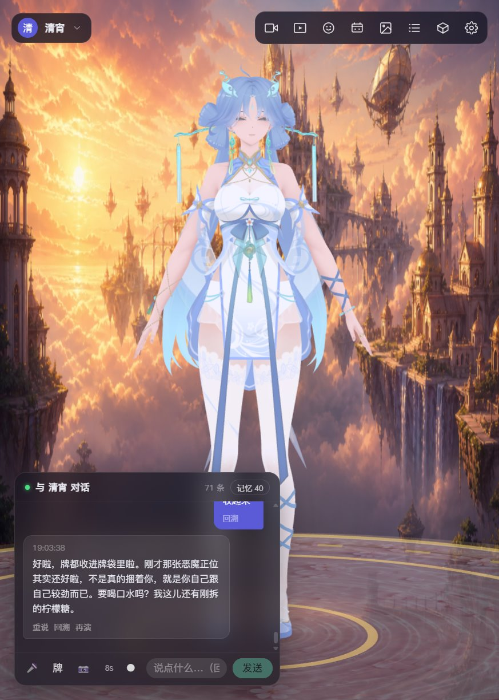
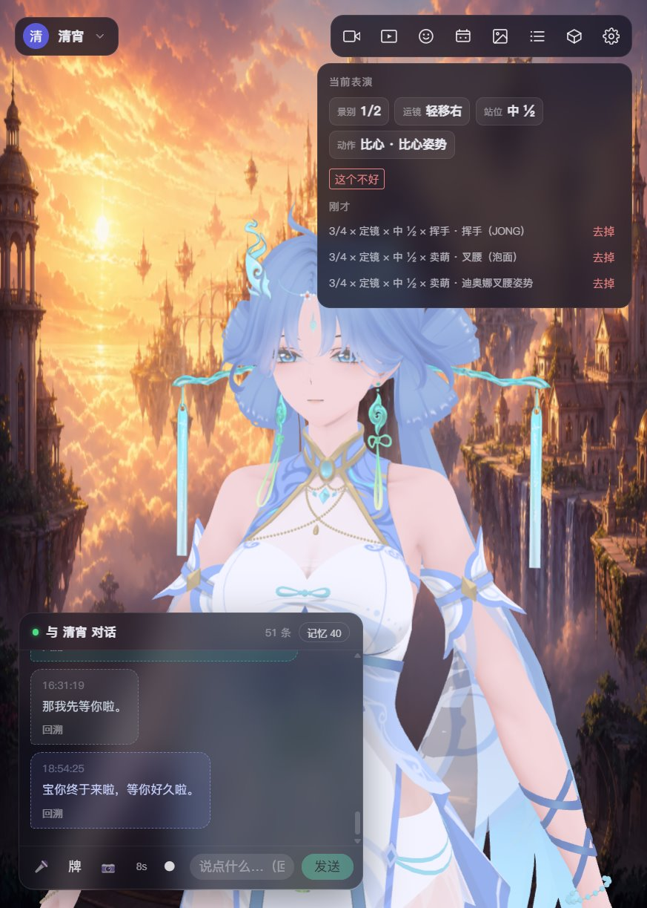
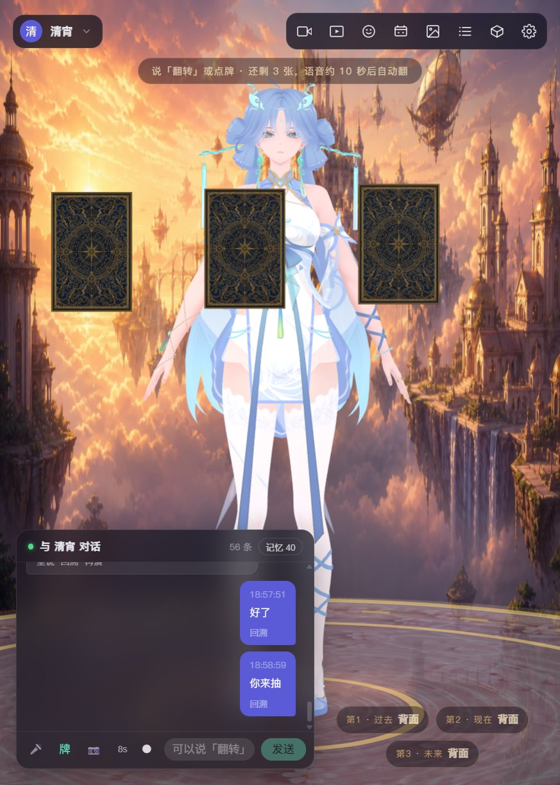

# xiaoke.ai

**An open-source, local-first 3D AI companion and transparent desktop pet.**

Voice chat with VRM, MMD (PMX), or GLB characters who speak, lip-sync, express emotions, move, dance, and remember you. Watch movies and videos, listen to music, play games, or simply share your desktop together.

**English** · [简体中文](./README.zh-CN.md) · [Website](https://xiaoke.ai) · [Download](#download-windows) · [Discord](https://discord.gg/xxvXxHP8T)

[](./LICENSE)
[](#download-windows)
[](#features)

## Why xiaoke.ai?

- **A companion you can see and hear.** Real-time 3D performance combines speech, lip-sync, expressions, motion, dance, and cinematic camera work—not just a text chat window.
- **Local-first and private by design.** Chats, long-term memory, keepsakes, and local model weights stay on your computer. Screen-companion video is processed locally; only the cloud services you configure receive their respective requests.
- **More than conversation.** Watch movies, short videos, and listen to music together; draw tarot cards, save memories, launch installed games, or interact with a livestream audience.
- **Your character, your setup.** Import VRM, MMD/PMX, and GLB models, use SillyTavern character cards and lorebooks, and choose local or cloud chat and speech providers.
- **Free and open source.** No membership or usage cap. The source is Apache 2.0; third-party models, motions, music, and voices retain their own licenses.

The interface and speech languages can be configured independently: **Simplified Chinese, English, Japanese, and Korean**.

## Preview

<table>
  <tr>
    <td width="50%"></td>
    <td width="50%"></td>
  </tr>
  <tr>
    <td align="center">Conversation becomes a live 3D performance</td>
    <td align="center">Direct the camera, stance, expression, and motion</td>
  </tr>
  <tr>
    <td></td>
    <td></td>
  </tr>
  <tr>
    <td align="center">Sit across from her for an interactive tarot reading</td>
    <td align="center">Create scenes and keep screenshots or short clips</td>
  </tr>
</table>

Characters shown in screenshots are demo assets created by [aplaybox](https://www.aplaybox.com/) authors. Copyright remains with the original authors.

## Download Windows

The current prebuilt pack is **2026-10-28**. It includes Chromium and a Python runtime, so neither Chrome nor a system Python installation is required. Source code may contain features added after this packaged release. See [Release History](./HISTORY.md) for previous packages and changes.

**Download both A and B with the identical timestamp.** The older unversioned `xiaoke-ai-B` is not compatible with this release. Baidu Netdisk uses one shared folder for both files; password: `xkai`.

| Pack | Purpose | Hugging Face | Google Drive | Baidu Netdisk |
|---|---|---|---|---|
| **A** · `xiaoke-ai-agent-A-20261028135252.7z` | Application and runtime | [Download](https://huggingface.co/datasets/liupigai/xiaokeai/resolve/main/xiaoke-ai-agent-A-20261028135252.7z) | [Download](https://drive.google.com/file/d/14drCVOg5XkpM2WLABRfX7YZZWE-jTgC0/view?usp=sharing) | [Shared folder](https://pan.baidu.com/s/1Y3KuQWG761eP08Uktx36Eg?pwd=xkai) |
| **B** · `xiaoke-ai-agent-B-20261028135252.7z` | Characters, motions, music, speech, and local vision models | [Download](https://huggingface.co/datasets/liupigai/xiaokeai/resolve/main/xiaoke-ai-agent-B-20261028135252.7z) | [Download](https://drive.google.com/file/d/1uA5Z9FyOcEthARaUMkdu0JcEt0B-yggk/view?usp=sharing) | [Shared folder](https://pan.baidu.com/s/1Y3KuQWG761eP08Uktx36Eg?pwd=xkai) |

1. Extract both archives with [7-Zip](https://www.7-zip.org/), side by side—not nested inside each other.
2. Open `xiaoke-ai.exe` in the A folder.
3. In **Settings → AI chat**, configure an OpenAI-compatible `base_url`, `api_key`, and `model`. Without a key, the stage and local fallback replies still work.
4. Import a PMX, VRM, or GLB character through the asset hub if you want to use your own model.

```text
D:\xiaoke\
  xiaoke-ai-agent-A-20261028135252\
    xiaoke-ai.exe
  xiaoke-ai-agent-B-20261028135252\
    xiaoke-content.json
```

**Requirements:** Windows 10+. An NVIDIA GPU is recommended for local Qwen TTS; without one, select **Settings → Speech → TTS → edge-tts**. The download does not include a chat API key.

<details>
<summary>Using an older pack?</summary>

For packs dated 2026-10-21 or earlier, pair the older A with `xiaoke-ai-B`, select that folder under **Settings → Content pack**, then restart the app. All-in-one archives without `-A` or `-B` can be opened directly. See [GitHub Releases](https://github.com/liupig/xiaokeai/releases) for previous A packages and release history.

</details>

## Features

### Chat, voice, and memory

- **38 chat-service presets plus custom endpoints:** OpenAI, Anthropic, Google Gemini, DeepSeek, Qwen, Doubao, Kimi, GLM, MiniMax, OpenRouter, and more. Local options include Ollama, vLLM, SGLang, and Player2; any OpenAI-compatible endpoint can also be configured manually.
- **Layered personas:** Separate identity, temporary role-play, time, scene, memory, and performance directions. Import SillyTavern v1/v2/v3 and AICC character cards, export v2 cards, and use keyword-triggered lorebooks and an optional user persona.
- **Long-term memory:** Extract preferences, relationships, and promises with mem0, store embeddings locally in Qdrant, and recall them in later conversations. Choose automatic routing or one of five explicit embedding backends: local MiniLM, Doubao, Qwen, OpenAI, or Gemini. Memory can be inspected and deleted.
- **Conversation controls:** Review transcripts, rewrite the previous reply, rewind to an earlier message, or perform the same line again with a different emotion without another model request.
- **Full-duplex interaction:** Listen while speaking, choose per-sentence interruption or queueing, and continue after silence. Silero VAD and WebRTC AEC3 help distinguish your voice from the companion's playback.
- **Four UI and speech languages:** Configure Simplified Chinese, English, Japanese, and Korean independently for the interface and conversation.

#### Speech recognition — 7 ASR options

| Engine | Runs | Model / notes |
|---|---|---|
| SenseVoice-Small | **Local, CPU** | Automatic Chinese, English, Japanese, Korean, and Cantonese recognition; approximately 230 MB |
| Alibaba Cloud Model Studio | Cloud | `qwen3-asr-flash` |
| Volcengine Doubao ASR 2.0 | Cloud | `volc.seedasr.sauc.duration` |
| OpenAI | Cloud | `gpt-transcribe` |
| ElevenLabs | Cloud | `scribe_v2` |
| Google Gemini | Cloud | `gemini-2.5-flash` audio understanding |
| Browser Web Speech | Cloud / browser | Chrome and Edge |

#### Speech synthesis — 9 TTS options, plus off

Local and cloud engines provide **300+ listed preset voices**. Lip-sync follows real audio amplitude; browser system speech does not provide true lip-sync.

| Engine | Runs | Model / voices |
|---|---|---|
| Qwen3-TTS | **Local, GPU, streaming** | 0.6B or 1.7B models, 9 shared voices, optional style instructions on 1.7B |
| Browser system speech | Local | Voices installed on the device |
| Xiaomi MiMo | Cloud, streaming | `mimo-v2.5-tts`, 9 preset voices with emotion directions |
| Volcengine Doubao TTS 2.0 | Cloud | `seed-tts-2.0`, 100 voices |
| Alibaba Cloud CosyVoice | Cloud, streaming | CosyVoice-v3-Flash, 88 voices |
| OpenAI TTS | Cloud | `gpt-4o-mini-tts`, 13 voices |
| ElevenLabs | Cloud, streaming | Flash v2.5, 52 official preset voices |
| Google Gemini TTS | Cloud, streaming PCM | 30 voices |
| edge-tts | Cloud, streaming | Microsoft neural voices, 11 built-in choices |

### 3D stage and performance

- **Three model formats:** Hot-swap VRM, MMD/PMX, and GLB characters, with MMD cloth physics for hair, skirts, and ribbons.
- **Stage appearance:** Choose from 20 image scenes, six solid-color backgrounds, or a custom image; adjust rendering resolution, lighting, physics, music volume, and the stage base.
- **Performed replies:** Streamed emotion, action, dance, camera, and stance tags drive expressions and movement in real time. A local fallback keeps the performance path usable without a chat API key.
- **Camera review:** Approve shot × camera × stance × motion combinations before they enter a performance to reduce clipping and mismatched movement.
- **Motion capture:** Use a webcam or a local video; MediaPipe Holistic tracks body, hands, and face in a Worker.
- **Transparent desktop pet:** Float the character above other windows, click through empty space, drag and resize her, and remember her size, position, display, and current character.

### Companionship and play

- **Watch together:** A separate local MiniCPM-V 4.7 1B process understands continuous video with real timestamps. Watch movies, short videos, and gameplay, or listen to music together with scene context and subtitle timelines. The picture and sound stay on your computer.
- **Omni test interface:** Try MiniCPM-o 4.5 text, speech, and image input through the ModelBest cloud or a self-hosted gateway, separately from the main stage pipeline.
- **Touch reactions:** Double-tap different body areas on the stage or desktop pet for context-aware poses and responses, with familiarity tracked separately from long-term memory.
- **Tarot and scenes:** Nine interactive spreads, 80 original Chinese-style card faces, code-controlled deals and orientations, and 22 built-in scene cards.
- **Keepsakes and creativity:** Save stage screenshots and short clips by character, generate drawings with Volcengine, and ask for weather, prices, or news.
- **Phantom Tavern:** A four-seat bluffing card game with model-driven opponents, scoring, four art styles, cinematic judgments, and non-blocking voiced play.
- **Games and code:** Launch installed WeGame, Steam, or Epic games by natural language; follow activity from Cursor, Codex, Claude Code, Tongyi Lingma, Trae, and Baidu Comate, then react on the stage.
- **Livestreams:** Receive Douyin and Bilibili chat, follows, and gifts with aggregation, deduplication, bounded queues, and playback receipts. Test the full pipeline in a local rehearsal lab with scripted viewers and fault injection.
- **Local coins and wishes:** Earn coins through idle time and chat, then use the wishing pool and its animated props and coin rain. No account or upload is required.

### Assets and customization

- **Asset hub:** Import ZIP/RAR archives or individual models, motions, cameras, and audio; repair mojibake filenames and classify assets automatically. Convert VPD poses to VMD, or use optional aplaybox search and download.
- **Character controls:** Bind a model, persona, voice, emotion-to-morph mapping, greeting, and idle-motion preferences to each character. Twenty-seven Chinese persona templates are included.
- **Modular experience:** Toggle memory, scenes, rewriting, keepsakes, tarot, Phantom Tavern, Code companion, touch, Harness, and livestream features independently. Watch-together and livestream integrations are off by default.
- **Branding:** Configure a shared logo and color theme for the app, window, tray, and installer.

Watch-together does not click or operate your computer, and its local vision process exits when watching stops or the app closes. See the [complete feature list](./companion/docs/features.en.md) for all 15 feature categories.

## Run from Source

**Prerequisites:** Windows, Node.js 18+, and Python 3.11+.

```bat
git clone https://github.com/liupig/xiaokeai.git
cd xiaokeai
```

Open two Command Prompt terminals. Alternatively, run `companion/start.bat` once to install dependencies and open both servers.

**Terminal 1 — backend** (`http://127.0.0.1:8600`)

```bat
cd companion\backend
python -m venv .venv
.venv\Scripts\python -m pip install -r requirements.txt
set NO_PROXY=*
set PYTHONUNBUFFERED=1
.venv\Scripts\python -m uvicorn app.main:app --host 127.0.0.1 --port 8600
```

**Terminal 2 — frontend** (`http://localhost:5175`)

```bat
cd companion\frontend
npm install --legacy-peer-deps
npm run dev
```

Open **http://localhost:5175** and configure your chat provider in Settings. The initial stage is empty until you import a model. Offline speech weights are downloaded when you prepare the corresponding model.

Do not start the backend with `--reload` or `--workers`; press **Ctrl+C** in both terminals to stop. Configuration, the performance-tag protocol, PowerShell commands, and troubleshooting are in the [developer guide](./companion/README.md) (Chinese).

## Repository Layout

| Path | Description |
|---|---|
| [`companion/`](./companion) | Main product: Vue frontend, FastAPI backend, and Electron desktop shell |
| [`companion/docs/`](./companion/docs) | Product design, personas, feature status, tarot, and development notes |
| [`companion-3d/`](./companion-3d) | Early standalone 3D rendering and motion prototype |
| [`music-api/`](./music-api) | Independent music-search research API |

The repository contains source code, scene backgrounds, stage textures, and original tarot artwork. It does not include third-party 3D models, motions, music, speech weights, databases, or API keys; see the `README.txt` files under [`companion/assets/`](./companion/assets) for asset placement.

## Tech Stack

- **Frontend:** Vue 3, TypeScript, Vite, Pinia, Naive UI, Three.js, three-vrm, three-stdlib, MediaPipe Holistic
- **Backend:** Python 3.11, FastAPI, SQLModel/SQLite, mem0, Qdrant, sherpa-onnx, SenseVoice, Qwen3-TTS
- **Desktop:** Electron, PyInstaller
- **Integrations:** OpenAI-compatible chat APIs, edge-tts, DashScope CosyVoice, MiMo-V2.5-TTS, MiniCPM-V

## Documentation

| Document | Contents |
|---|---|
| [Developer guide](./companion/README.md) | Configuration, speech providers, tag protocol, and troubleshooting (Chinese) |
| [Windows packaging](./companion/README_BUILD.md) | Build a double-click desktop distribution (Chinese) |
| [Complete feature list](./companion/docs/features.en.md) | All 15 categories of currently implemented features |
| [Persona guide](./companion/docs/persona-guide.md) | Character cards and layered persona design (Chinese) |
| [Prompt stack](./companion/docs/persona-stack.md) | How system prompts are assembled (Chinese) |
| [Tarot design](./companion/docs/tarot.md) | Tarot interaction, framing, and stage integration (Chinese) |

## Community

- **Discord:** [Join the community](https://discord.gg/xxvXxHP8T)
- **QQ group:** `1124054481`
- **Contributing:** Forks, self-hosting, issues, and pull requests are welcome.

## License and Credits

Source code and project-generated tarot/scene art are licensed under [Apache License 2.0](./LICENSE). The xiaoke.ai / 小可爱 names and marks are not transferred; third-party models, motions, cameras, music, and voices remain under their authors' terms. See [NOTICE](./NOTICE) before redistributing or using assets commercially.

Thanks to the [aplaybox](https://www.aplaybox.com/) community and its asset authors, [Reze MiPo](https://github.com/AmyangXYZ/reze-mipo) for the motion-capture approach, and the teams behind Three.js, VRM, MMD, MediaPipe, Vue, FastAPI, Electron, mem0, Qdrant, Qwen, SenseVoice, and the other open-source projects that make xiaoke.ai possible.

Character-card compatibility builds on the open ecosystem established by [SillyTavern](https://github.com/SillyTavern/SillyTavern) and the community [Character Card V2 specification](https://github.com/malfoyslastname/character-card-spec-v2). xiaoke.ai imports compatible cards and adapts Lorebooks to its own layered prompt stack and 3D stage; it does not claim the card formats or Lorebook concept as original work. Card authors retain their copyrights, and compatibility does not imply affiliation with SillyTavern.

Cloud LLM, ASR, and TTS providers process the text or audio sent to them under their own privacy policies. Tarot is for psychological reflection and entertainment, not professional advice.

<details>
<summary>Search keywords / 搜索关键词</summary>

Open-source 3D AI companion, 3D AI companion, local AI companion, AI companion, AI waifu, waifu, awesome-ai, virtual companion, transparent desktop pet, VRM chatbot, MMD desktop pet, AI VTuber, AI movie companion, watch a movie together, watch videos together, listen to music together; 开源 3D AI 伴侣、AI 伴侣、本地 AI 伴侣、开源 3D 陪玩、虚拟陪玩、本地桌宠、透明桌宠、VRM 聊天、MMD 陪玩、AI 虚拟主播、陪看电影、陪刷视频、陪听音乐、视觉互动。

</details>
