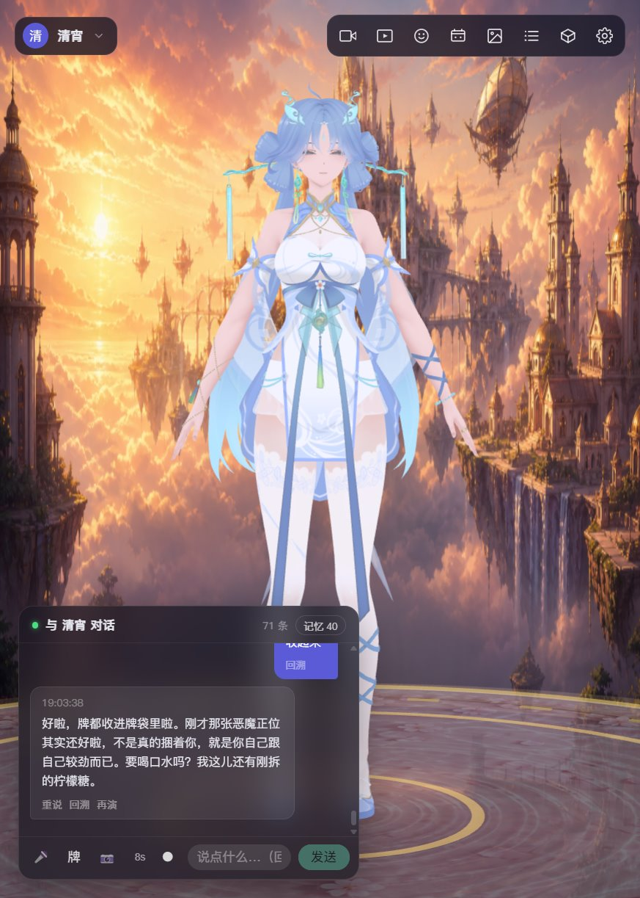
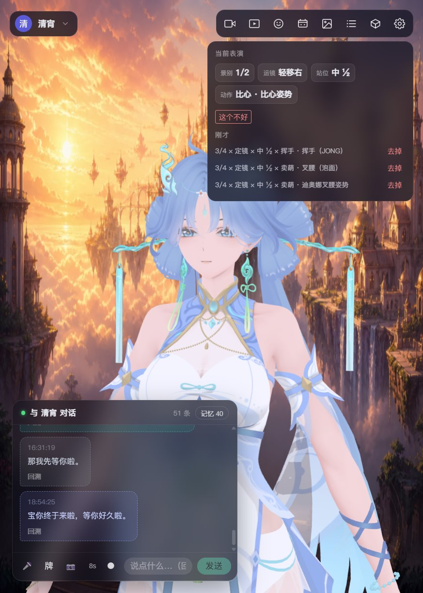
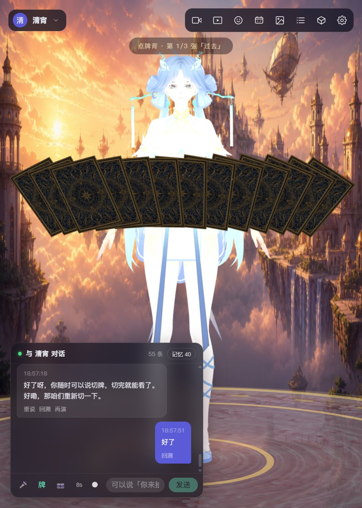
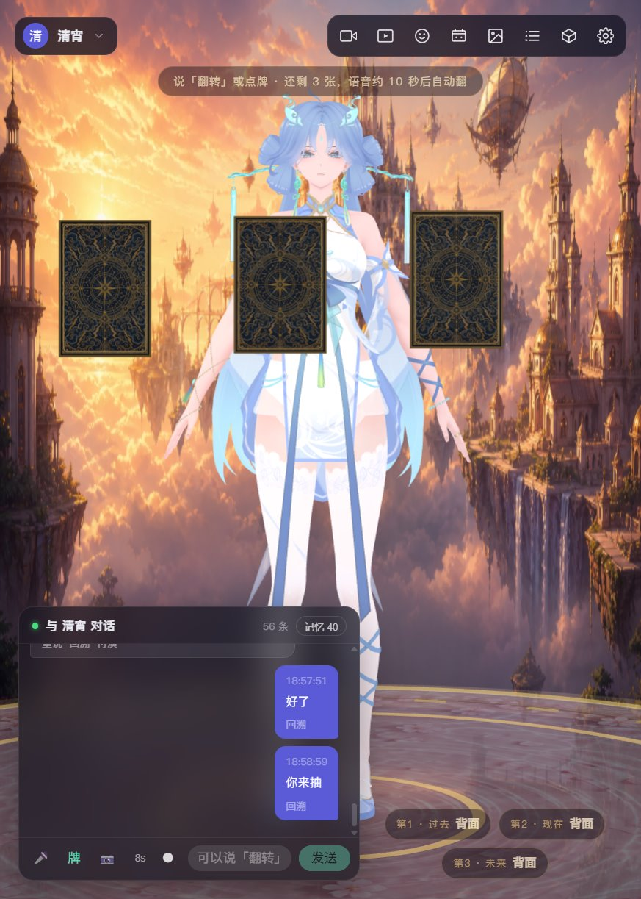
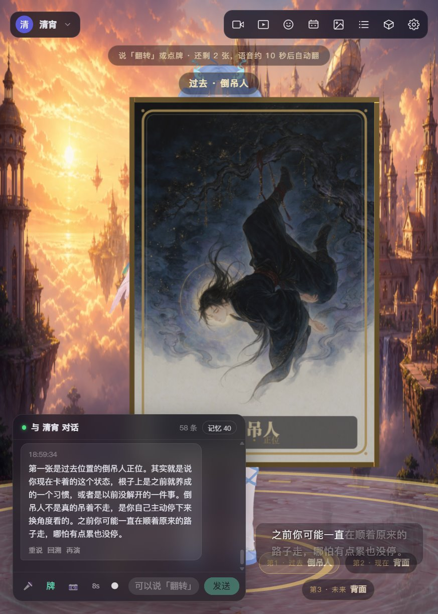
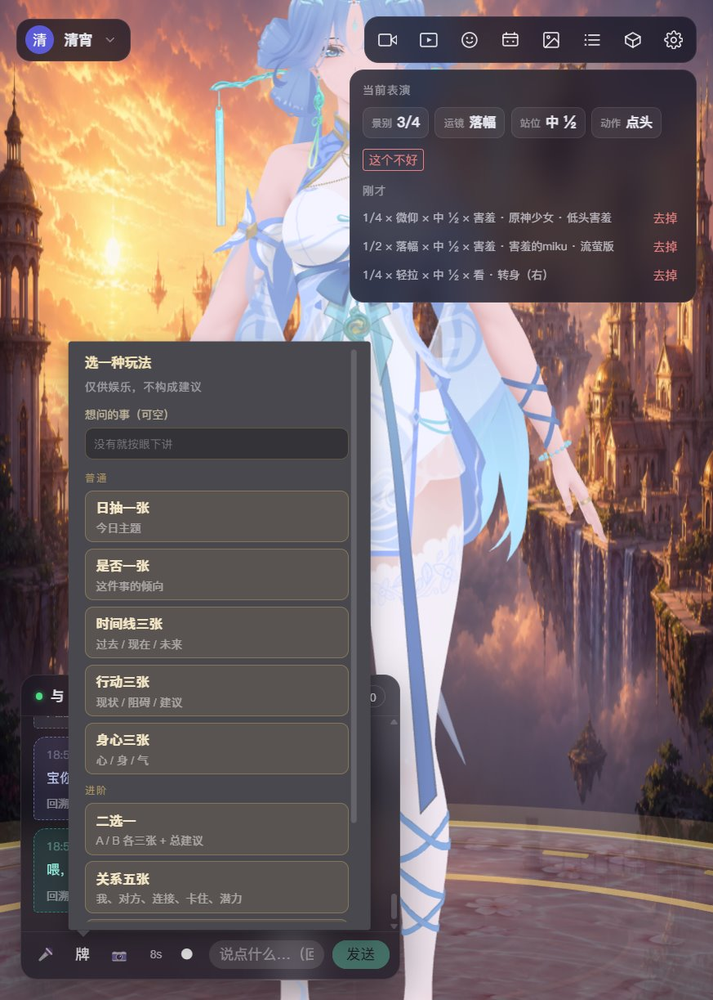
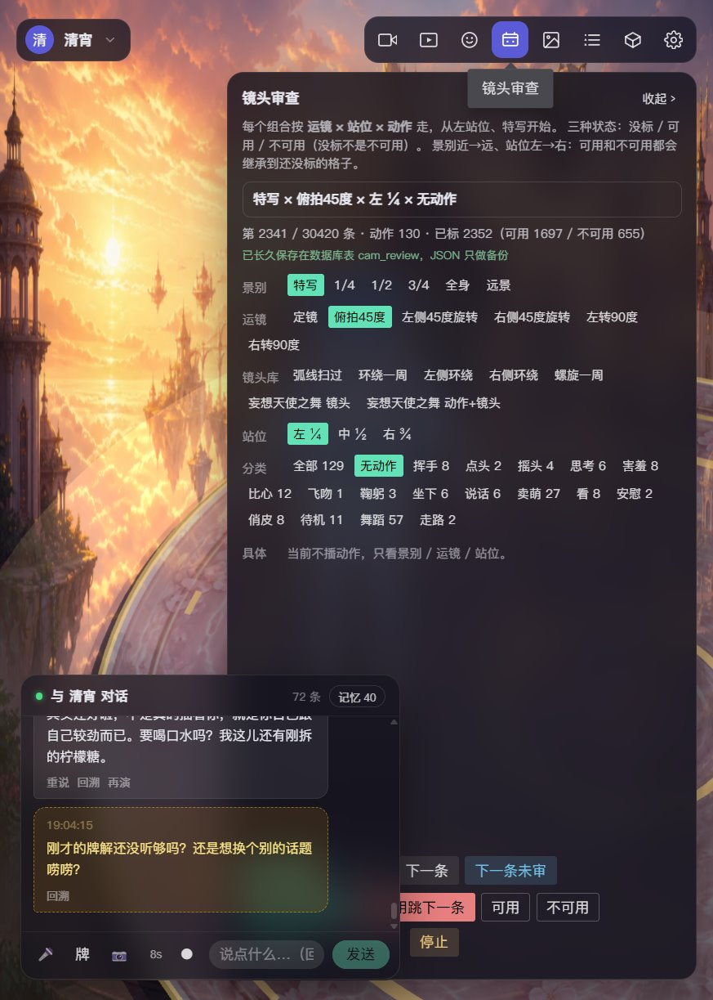
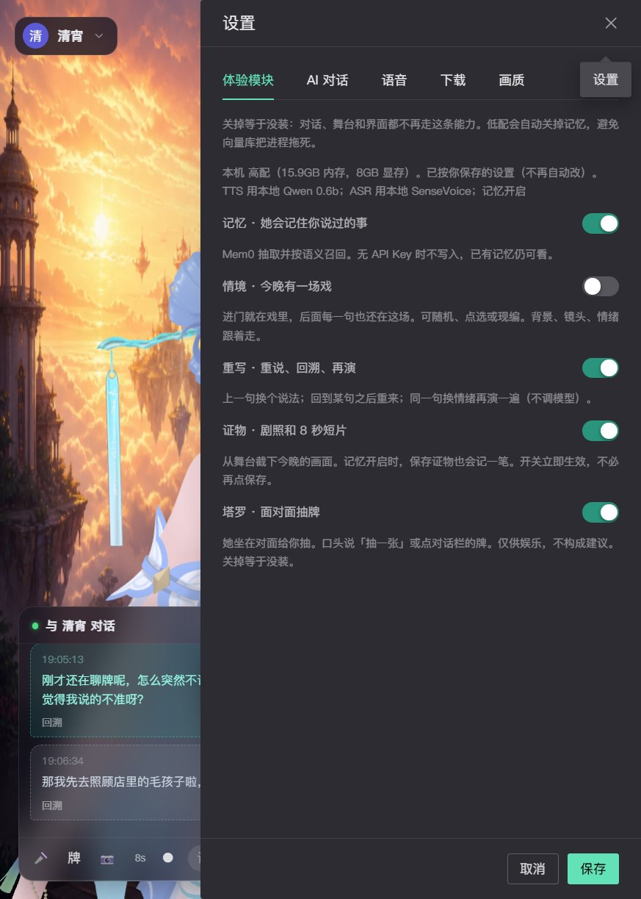
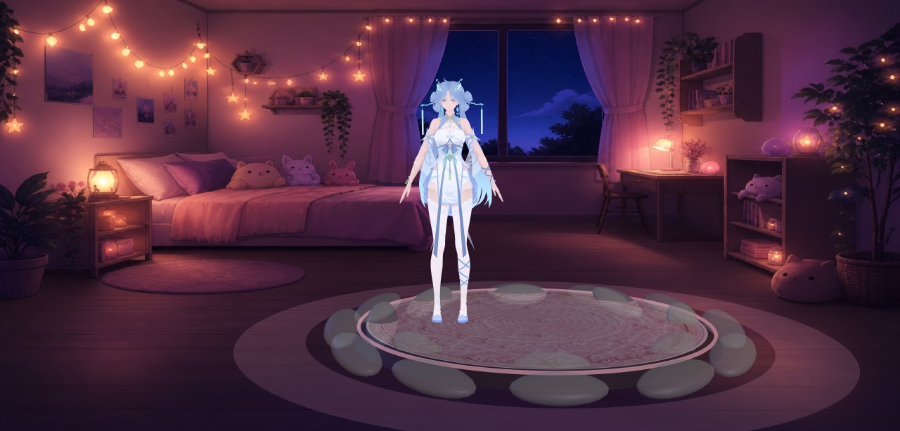
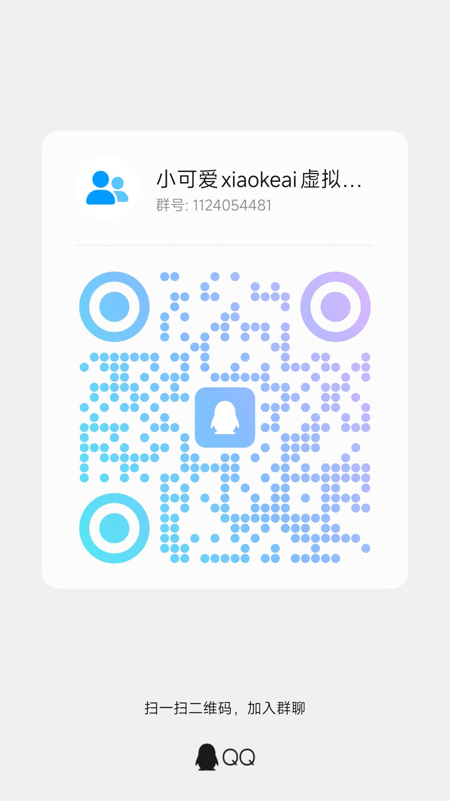

# xiaoke.ai

Open-source **3D AI companion** / desktop pet · waifu · awesome-ai · 开源3D AI伴侣 / 本地3D陪玩 / 虚拟陪玩 / 透明桌宠 / 陪看电影刷视频听音乐

[English](#english) · [中文](#中文) · [xiaoke.ai](https://xiaoke.ai)

---

## English

**xiaoke.ai** (小可爱) is an open-source **3D AI companion**: a local desktop 3D virtual companion. A VRM, MMD (PMX), or GLB character sits across from you: voice chat, lip-sync, expression, motion, dance, and camera, with tarot and long-term memory kept on the machine. She can also stay for a movie, a short video, or a song. A local eye watches the screen and hears the sound; the picture never leaves this computer, and she speaks only when there is something worth saying. In the desktop app she can leave the stage and float as a transparent desktop pet. Interface language and speech language are separate: Simplified Chinese, English, Japanese, and Korean.

Also called: open-source 3D AI companion, 3D AI companion, AI companion, local AI companion, transparent desktop pet, waifu, awesome-ai, watch a movie together, AI movie companion, 开源 3D AI 伴侣, AI 伴侣, 本地 AI 伴侣, 开源 3D 陪玩, 虚拟陪玩, 本地桌宠, 透明桌宠, VRM chatbot, MMD desktop pet, AI VTuber, 陪看电影, 陪刷视频, 陪听音乐, 视觉互动.

> **Open source · free · runs on your machine — someone who talks, moves, remembers you, and will stay for a movie, a video, or a song, sitting across the desk.**

- **Open source**: frontend and backend are public; how to run and how to change them is in the docs.
- **Free**: no paywall, membership, or usage cap. LLM and speech can stay local or use free providers.
- **Local**: chat, memory, keepsakes, and speech weights live on your computer. Only the LLM / cloud TTS you configure sees requests.
- **Source is commercial-ok**: [Apache License 2.0](./LICENSE) — use, modify, redistribute, including commercially. The names “xiaoke.ai” / “小可爱” are not transferred; see [NOTICE](./NOTICE).

Stage 3D models, motions, music, and voices are **not** under that license. Copyright stays with each author; follow each asset’s own terms (most prohibit commercial use and redistribution).

### What this is: a local 3D companion

Not a text chatbot and not a browser popup. The character is a VRM, MMD, or GLB model on a stage. A reply is spoken, lip-synced, and performed: face, motion, dance, camera. She can also keep you company through a movie, a short video, or a song: the picture and the sound stay on this machine, and she talks when a moment is worth it. The desktop app can also shrink her into a transparent window that stays on the desktop. Chat, memory, and speech weights stay on the computer. UI and speech can each be Chinese, English, Japanese, or Korean. Source is Apache 2.0 and may be used commercially. No membership, no usage cap.

### Look

<table>
  <tr>
    <td width="50%"></td>
    <td width="50%"></td>
  </tr>
  <tr>
    <td align="center">Talk is performance: face, motion, and camera follow the line</td>
    <td align="center">Top-right shows this line’s shot × camera × stance × motion; drop one if it is wrong</td>
  </tr>
  <tr>
    <td></td>
    <td></td>
  </tr>
  <tr>
    <td align="center">After the cut, backs fan in front of her; tap one or say “you draw”</td>
    <td align="center">Three cards land; she only speaks the one you flip</td>
  </tr>
  <tr>
    <td></td>
    <td></td>
  </tr>
  <tr>
    <td align="center">The card comes to camera; 80 original Chinese-style faces; she meets the feeling first, no fortune-telling</td>
    <td align="center">Daily, yes/no, three-card, either-or, relationship / career five, Celtic Cross</td>
  </tr>
  <tr>
    <td></td>
    <td></td>
  </tr>
  <tr>
    <td align="center">Camera review: tens of thousands of shot × camera × stance × motion rows, marked usable or not</td>
    <td align="center">Memory, scene, rewrite, keepsake, tarot are toggles; off means not installed</td>
  </tr>
  <tr>
    <td></td>
    <td></td>
  </tr>
  <tr>
    <td align="center">Stage stills in the keepsake album: scene cards change backdrop and light</td>
    <td align="center">Same character, another night</td>
  </tr>
</table>

Characters in the screenshots are by aplaybox authors, for demo only. Copyright stays with them.

### What’s in this repo

| Path | What it is |
|---|---|
| [`companion/`](./companion) | **Main product**: Vue frontend + FastAPI backend + Electron desktop shell |
| [`companion/docs/`](./companion/docs) | Design notes: writing a persona, prompt layers, tarot rules and card art, original lyrics |
| [`companion-3d/`](./companion-3d) | Early 3D stage prototype: VRM / GLB / PMX load, expressions, VMD dance |
| [`music-api/`](./music-api) | Standalone research music search API (data source: 爱听音乐网) |

Use `companion/` day to day. `companion-3d` is a smaller sandbox for the render and motion pipeline.

This repo ships **full source**, scene-card backgrounds / stage textures, and the full set of AI-original tarot faces. 3D models, VMD, music, speech weights, SQLite, and API keys stay local. `companion/assets/` keeps empty `models` / `motions` / `cameras` / `audio` / `music` folders with a `README.txt` in each. After clone the stage is empty — import in the asset hub, or drop files where those notes say.

To build a double-click Windows exe (bundled Chromium, Python runtime, models and weights), see [`companion/README_BUILD.md`](./companion/README_BUILD.md) (Chinese).

### Ready-made pack (no compile)

Windows packs are on Hugging Face, Google Drive, and Baidu Netdisk. From 2026-10-28 the pair is `xiaoke-ai-agent-A-时间戳` and `xiaoke-ai-agent-B-同一时间戳`. **Download both of this date.** An older `xiaoke-ai-B` does not run this A. A is also attached to the GitHub release. Packs dated 2026-10-21 and earlier can still replace only A when that older B already runs.

The 2026-10-28 pair sits at the Hugging Face repo root. Later packs go in a timestamp folder first, then the files. Baidu is one share for both files. Password: `xkai`.

| Pack | [Hugging Face](https://huggingface.co/datasets/liupigai/xiaokeai/tree/main) | [Google Drive](https://drive.google.com/drive/folders/1mZcD4K90WgO2x2UxteAyMFsQlgTairPl?usp=drive_link) | [Baidu Netdisk](https://pan.baidu.com/s/1Y3KuQWG761eP08Uktx36Eg?pwd=xkai) |
|---|---|---|---|
| A `xiaoke-ai-agent-A-20261028135252.7z` | [download](https://huggingface.co/datasets/liupigai/xiaokeai/resolve/main/xiaoke-ai-agent-A-20261028135252.7z) | [download](https://drive.google.com/file/d/14drCVOg5XkpM2WLABRfX7YZZWE-jTgC0/view?usp=sharing) | [same share](https://pan.baidu.com/s/1Y3KuQWG761eP08Uktx36Eg?pwd=xkai) |
| B `xiaoke-ai-agent-B-20261028135252.7z` | [download](https://huggingface.co/datasets/liupigai/xiaokeai/resolve/main/xiaoke-ai-agent-B-20261028135252.7z) | [download](https://drive.google.com/file/d/1uA5Z9FyOcEthARaUMkdu0JcEt0B-yggk/view?usp=sharing) | [same share](https://pan.baidu.com/s/1Y3KuQWG761eP08Uktx36Eg?pwd=xkai) |

#### Pack updates

Newest first. The link above does not change when a new A is uploaded.

| Date | Pack | What changed |
|---|---|---|
| 2026-10-28 | `xiaoke-ai-agent-A-20261028135252.7z` + `xiaoke-ai-agent-B-20261028135252.7z` | **Both packs are required.** Extract them side by side with the same timestamp; A finds that B on its own. The old unversioned `xiaoke-ai-B` does not work. Since 2026-10-21: she can watch a movie, a short video, or a song with you. B carries the local MiniCPM-V 4.7 1B eye as its own process, sharing the speech PyTorch. Say “一起看” or press the eye. The picture stays on this machine, and she speaks only when a moment is worth it. She looks at the show, not her own window or the input-method window. The watch log opens from Settings, not at startup. Ordinary talk goes through the built-in dsh. She can draw a picture onto a card (Volcengine) and look up weather, prices, and news. Local Qwen speech returns without hanging on the first warmup. A physics error no longer leaves a PMX stuck at 12.5×, including after a character switch. This B ships 清宵, kelu, and chun. The desktop pet keeps the current character when the window is rebuilt. Chat, speech, and the stage keep moving while the wallet and the eyes work. Wishes are 50 a day. A Doubao character model needs an Ark endpoint id that starts with `ep-` while Harness is on. A is also on [GitHub](https://github.com/liupig/xiaokeai/releases/tag/a-20261028). Hugging Face, Google Drive, and Baidu links are in the download table above. |
| 2026-10-21 | `xiaoke-ai-A-20261021090448.7z` | Coins and a wishing pool. Idle time, chat, and one wish a day mint coins. Say you want to make a wish and painted props drop into the pool, then coins rain beside it. The pool and prop art ship in A. `xiaoke-ai-B.7z` was packed the same day; keep an older B if it already runs. Also on [GitHub](https://github.com/liupig/xiaokeai/releases/tag/a-20261021). |
| 2026-10-19 | `xiaoke-ai-A-20261019211256.7z` | The pet window opens: the screen helper ships in A. Spoken tarot works in the pet because the locale files sit next to the exe. Local Qwen TTS can load again. The title bar shows the QQ group and Discord invite; a click copies them. `xiaoke-ai-B.7z` was packed the same day; keep an older B if it already runs. |
| 2026-10-17 | `xiaoke-ai-A-20261017202306.7z` | The pet remembers her screen and where she stood, and lands on a display that is still there if that screen is unplugged. Tarot controls follow her while she floats. Online speech vendors, a window reload, and memory that keeps pinned lines and emotional events after they leave the chat. Keep the 2026-10-12 B if it already runs. Also on [GitHub](https://github.com/liupig/xiaokeai/releases/tag/a-20261017). |
| 2026-10-12 | `xiaoke-ai-A-20261012184939.7z` | Desktop pet: in the Electron window she can leave the stage and float as a small transparent always-on-top window. Empty space clicks through; drag her body to move, drag the corner to resize. `xiaoke-ai-B.7z` was packed the same day; keep an older B if it already runs. |
| 2026-10-11 | `xiaoke-ai-A-20261011203508.7z` | Interface language and speech language are separate: Simplified Chinese, English, Japanese, Korean. English stays a woman’s voice (Serena). Japanese is Ono Anna, Korean is Sohee. Settings, tarot, and scenes follow the language you pick. `xiaoke-ai-B.7z` was packed the same day; keep an older B if it already runs. |
| 2026-09-04 | `xiaoke-ai-A-20260904233641.7z` | First published Windows A/B pack: desktop 3D companion, voice, lip-sync, motion, dance, camera, tarot, memory. |

| You downloaded | What it is | How to open |
|---|---|---|
| `xiaoke-ai-agent-A-….7z` | **A program pack** from 2026-10-28 on: window, code, slim Python | Extract next to the **same-timestamp** B, then double-click `xiaoke-ai.exe` |
| `xiaoke-ai-agent-B-….7z` | **B content pack** for that stamp: characters, motions, songs, offline speech, PyTorch/CUDA, and the MiniCPM-V 4.7 1B eye | After extract you should see `xiaoke-content.json`. **Required** with the matching A |
| `xiaoke-ai-A-….7z` | Older A, through 2026-10-21 | Pair it with the old `xiaoke-ai-B` |
| `xiaoke-ai-B.7z` | Older B, no timestamp | Does **not** run the 2026-10-28 A |
| `xiaoke-ai-20….7z` (no `-A` / `-B`) | **All-in-one**: program and content in one folder | Extract and double-click `xiaoke-ai.exe`; no B picker |

Extract with [7-Zip](https://www.7-zip.org/). Do not nest A inside B or the other way around. It should look like:

```
D:\xiaoke\
  xiaoke-ai-agent-A-20261028135252\   ← double-click xiaoke-ai.exe here
    xiaoke-ai.exe
  xiaoke-ai-agent-B-20261028135252\
    xiaoke-content.json
```

**2026-10-28 and later**: put the same-timestamp A and B side by side and open `xiaoke-ai.exe`. A recognizes that B. Both packs have to be this pair. **Older packs**: Settings → Content pack → pick the sibling `xiaoke-ai-B` folder (look for `xiaoke-content.json`) → **quit and open again**. The path is stored as `content.path` in the A folder. The all-in-one pack skips this step.

The pack ships its own Chromium; you do not need a browser. Local ports are backend `127.0.0.1:5201` and frontend `127.0.0.1:5211`.

- Windows 10+. Local Qwen TTS prefers an NVIDIA GPU and driver; without one, Settings → Speech → TTS → edge-tts.
- The pack has **no** chat API key. Settings → AI chat: fill an OpenAI-compatible `base_url` / `api_key` / `model`. Empty still gets the stage, dance, and a local fallback reply.
- Do not delete `electron/` or `runtime/` inside A. 3D characters stay copyright of their authors; personal use.

Building from source: [`companion/README_BUILD.md`](./companion/README_BUILD.md).

### What it does

#### Stage and performance

- **3D stage**: hot-swap PMX (MMD), VRM, and GLB; MMD cloth physics via ammo.js (hair, skirts, ribbons).
- **Performed chat**: the LLM streams `[emo:]` `[act:]` `[dance:]` `[cam:]` tags and switches face, motion, dance, and camera live. No API key still gets a local fallback so the performance path works.
- **Camera review**: every shot × camera × stance × motion row is scored; only reviewed combos enter the show, to avoid clipping or mismatched moves.
- **Live mocap**: webcam, or a local video for repeatable tests. MediaPipe Holistic runs in a Worker (body, both hands, face) and drives the current character. The solver follows [Reze MiPo](https://github.com/AmyangXYZ/reze-mipo).
- **Desktop pet**: in the Electron window, the top bar button “Float on desktop” replaces the stage with a small always-on-top transparent window. Empty space clicks through to the desktop; drag her body to move her, and drag the corner to resize. She walks on her own and stands still while you talk, she replies, or you drag. A bubble by her head is text and the mic. “Back to the stage” restores the full window. Size and place are remembered. The browser dev page stays the full stage.

#### Talk and voice

- **Layered persona**: the character card only holds identity and speech; scene packs, role overlays, time slots, memory, and the director handbook are restacked each turn. Temporary overlays such as “play the teacher” can go on and off without polluting the long-term persona. Built-in character 清宵 is ready to talk.
- **Languages**: interface and speech are separate. Simplified Chinese, English, Japanese, and Korean. Changing the speech language switches to that language’s default voice.
- **Full-duplex speech**: listen while speaking, queue or barge-in per sentence, then delayed continue / proactive talk after silence. ASR and TTS can each be online or offline. Online: Web Speech + edge-tts / DashScope CosyVoice. Offline: SenseVoice-Small + Qwen3-TTS (local streaming). Lips follow real amplitude; captions stay in sync.
- **Rewrite**: say the same line another way; performance tags still come through.
- **Long-term memory**: preferences, people, and promises are extracted into mem0 + a local vector store and injected into later prompts. Role-play and card-reading turns stay out of memory by default.

#### Play together

- **Tarot**: not a popup mini-game — she sits across from you and deals. Backs rise from the table into a ring; the drawn card flies between her and the camera and flips; she tells each one in her own voice. Daily, yes/no, past-present-future, situation-obstacle-advice, body-mind, either-or, relationship five, career five, Celtic Cross. Deal and upright/reversed are decided in code; the model must not change them. 80 original Chinese-style faces ship with the repo. Psychological / entertainment framing, not fortune-telling.
- **Scene cards**: built-in “tonight’s scene” (rain alley, after a fight, under the blossoms, …), or a card generated from memory.
- **Keepsakes**: stage stills and short clips (mediabunny), filed by character.
- **Transcript**: a side drawer for this session’s chat and the backend talk log.
- **Code companion**: tap 「码」 in the chat bar. She watches Cursor start, write, and finish, then plays along. Defaults to local transcripts; an optional user hook. Codex later.
- **Watch together**: off by default. She can sit with you through a movie, a short video, or a song. The eye on the top bar, or beside the desktop pet, or saying “watch with me” / “turn vision on”, starts a separate local vision process. The picture and the sound stay there; chat only receives a short note, and she speaks when there is something worth saying. Press the eye again, or say “stop watching” / “turn vision off”, and the process exits. Closing the app exits it too. She does not click or operate the computer. Settings → Experience modules → “Open the watch log” opens the local page in the browser. It no longer opens when the service starts. Recent screenshots can stay on this machine for a few days.

#### Assets and characters

- **Asset hub**: import zip / rar / single files (extract, mojibake filename fix, auto-file PMX / VMD / audio); optional search and download from [aplaybox](https://www.aplaybox.com/).
- **Character cards**: model + persona + voice + emotion-to-morph map + idle motion.
- **Module toggles**: memory, scene, rewrite, keepsake, tarot, Code companion, touch, and Harness are on by default. Watch together is off. Off means that path is not used. Ordinary talk goes through the built-in dsh (`deepseek-harness-sdk`, installed with the backend). She can also draw a picture onto a card and look up weather, prices, and news. Drawing always uses Volcengine: the chat key when chat is already there, otherwise `ARK_API_KEY`. See [`companion/docs/features.md`](./companion/docs/features.md) and [`companion/docs/dsh施工图.md`](./companion/docs/dsh施工图.md).

Setup, tag protocol, and troubleshooting: [`companion/README.md`](./companion/README.md) (Chinese).

### Stack

#### Frontend (`companion/frontend`)

| Layer | Choice |
|---|---|
| App | Vue 3, TypeScript, Vite, Pinia, Naive UI |
| Render | [Three.js](https://threejs.org/) 0.185 |
| VRM | [@pixiv/three-vrm](https://github.com/pixiv/three-vrm) |
| MMD | [three-stdlib](https://github.com/pmndrs/three-stdlib) MMDLoader / MMDPhysics + ammo.js |
| Mocap | [MediaPipe Holistic](https://ai.google.dev/edge/mediapipe/solutions/vision/holistic_landmarker) (Worker) |
| Speech UI | Web Speech API, [@ricky0123/vad-web](https://github.com/ricky0123/vad) (Silero VAD), AEC3 |
| Clips | [mediabunny](https://github.com/Vanilagy/mediabunny) |

Engine code lives in `companion/frontend/src/engine/` (stage, character, motion, face, lips, camera, idle, `StagePlugin`). Features live in `features/` (chat, voice, performance, assets, character, mocap, memory, scene, keepsake, tarot, camera review, desktop pet).

#### Backend (`companion/backend`)

| Layer | Choice |
|---|---|
| Server | Python 3.11, FastAPI, uvicorn, SQLModel (SQLite) |
| Chat | OpenAI-compatible HTTP (通义, DeepSeek, Volcengine, …); `prompt_stack` restacks layers each turn |
| Memory | [mem0](https://github.com/mem0ai/mem0) + local [Qdrant](https://qdrant.tech/); cloud embedding or on-device MiniLM |
| ASR | [sherpa-onnx](https://github.com/k2-fsa/sherpa-onnx) running [SenseVoice-Small](https://github.com/FunAudioLLM/SenseVoice) |
| TTS | [Qwen3-TTS](https://github.com/QwenLM/Qwen3-TTS) local streaming; fallback [edge-tts](https://github.com/rany2/edge-tts), DashScope CosyVoice |
| Play | `modules/tarot` dealer + ritual state machine; `modules/scenes`, `memory`, `rewrite`, `keepsake` share the same toggles |

#### Desktop shell (`companion/desktop`, `build_exe.py`)

Electron ships the Chromium window, either the full stage or a transparent desktop pet. PyInstaller builds a single-file launcher that starts frontend and backend. The release folder includes a Python runtime, backend bytecode, packed frontend, models, and speech weights. The target PC needs neither Chrome nor Python. The 2026-10-12 pack on the share link includes the desktop pet. The 2026-10-11 pack does not.

### Quick start

Needs Windows, Node.js 18+, Python 3.11+. An NVIDIA GPU helps local Qwen3-TTS; online speech is a full fallback.

Use two terminals of your own. Do not leave the servers as Cursor background jobs (they often survive as orphans after the chat ends).

#### Start

**Terminal 1 · backend** (http://127.0.0.1:8600)

```bat
cd companion\backend
set NO_PROXY=*
set PYTHONUNBUFFERED=1
.venv\Scripts\python.exe -m uvicorn app.main:app --host 127.0.0.1 --port 8600
```

PowerShell, first two lines:

```powershell
$env:NO_PROXY='*'; $env:PYTHONUNBUFFERED='1'
```

**Terminal 2 · frontend** (http://localhost:5175)

```bat
cd companion\frontend
npm run dev
```

Open http://localhost:5175. Fill an OpenAI-compatible `base_url` / `api_key` / `model` in Settings for real chat.

Notes:

- Do **not** pass `--reload` or `--workers` on the backend. After Python changes, Ctrl+C in terminal 1 and start that uvicorn line again.
- First-time venv and deps: `python -m venv .venv`, then `.venv\Scripts\pip install -r requirements.txt`; frontend `npm install --legacy-peer-deps`. Or run `start.bat` once under `companion/` to install and open two windows.

#### Stop

Ctrl+C in both terminals. If a port is still held (the page talks to an old process):

```powershell
foreach ($port in 8600, 5175) {
  Get-NetTCPConnection -LocalPort $port -State Listen -ErrorAction SilentlyContinue |
    ForEach-Object { taskkill /PID $_.OwningProcess /T /F }
}
```

An empty stage is expected until you drop a PMX / VRM / GLB into the asset hub. Offline ASR / TTS weights download on first “prepare model”; do not commit `companion/backend/data/`.

### Docs index

| Doc | Contents |
|---|---|
| [`companion/README.md`](./companion/README.md) | Config, tag protocol, FAQ |
| [`companion/README_BUILD.md`](./companion/README_BUILD.md) | Pack a double-click exe folder |
| [`companion/docs/persona-guide.md`](./companion/docs/persona-guide.md) | Writing a character card: short base, rules per scene, role-play as its own layer |
| [`companion/docs/persona-stack.md`](./companion/docs/persona-stack.md) | How each turn’s system prompt is stacked, and why |
| [`companion/docs/personas/`](./companion/docs/personas) | Paste-ready persona text (清宵, generic) |
| [`companion/docs/tarot.md`](./companion/docs/tarot.md) | Tarot framing, compliance, ritual flow, how it meets the stage |
| [`companion/docs/tarot-cards.md`](./companion/docs/tarot-cards.md) | Per-card design and art notes for the 80 faces |
| [`companion/docs/songs/`](./companion/docs/songs) | Original Chinese-style lyrics used on stage |
| [`companion/docs/features.md`](./companion/docs/features.md) | Feature catalog by category, with done / partial / won't-do |
| [`companion/docs/TODO.md`](./companion/docs/TODO.md) | Backlog with history; each item marked done or not |
| [`companion/docs/bugs.md`](./companion/docs/bugs.md) | Bug and fix log |

Most of the docs above are in Chinese.

### Acknowledgements

We stand on work other people already shipped. Please tell us if we missed someone.

#### aplaybox, and every author there

The stage would be empty without **[模之屋 / aplaybox](https://www.aplaybox.com/)**.

Almost every 3D model, facial morph, VMD motion, and camera file we use comes from aplaybox: it is both the search/download door and the place MMD authors have been sharing work for years.

We also thank every author who published models, expressions, motions, or cameras there. The characters only “live” in the browser because of that work. Copyright stays with each author. Keep credit lists, follow each work’s own terms, and do not redistribute or use commercially. Do not commit an aplaybox token to this repo.

#### Ideas and algorithms

- **Xiaoice (小冰)**  
  Full-duplex spoken interaction: listen while speaking, queue or barge-in per sentence, then delayed continue / proactive / goodbye after silence. Our dialogue timing (`DuplexCmd`, sentence types, play-or-skip in the pool) follows that side of Xiaoice, instead of locking a whole reply before playback.
- **Doubao (豆包)**  
  Multi-part system restacked each turn, account-level persona vs session role-play, memory guardrails, code-side intercept before prompt text. Our `prompt_stack` is inferred from that public behavior; see [`persona-stack.md`](./companion/docs/persona-stack.md).
- **[AmyangXYZ](https://github.com/AmyangXYZ) / [Reze MiPo](https://github.com/AmyangXYZ/reze-mipo)** (formerly MiKaPo)  
  MediaPipe landmarks → MMD parent-local quaternions: rest `parent → child` world direction as the reference, shortest-arc per frame, witness bones for arm/thigh roll. Our solver in `companion/frontend/src/features/mocap/` follows that pipeline and adapts it for PMX / VRM / GLB.
- **Géry Casiez, Nicolas Roussel, Daniel Vogel** — [1€ Filter](https://gery.casiez.net/1euro/) (CHI 2012)  
  One-Euro smoothing on mocap: damp jitter at rest, open the cutoff on fast motion.
- **Higuchi Yu / MikuMikuDance**  
  PMX, VMD, morphs, and rigid-body physics — the workflow the stage dances on.
- **pixiv / VRoid**  
  The VRM spec lets non-MMD characters share the same expression and bone semantics.
- **Rider–Waite tarot tradition**  
  Names, numbers, and symbols follow the tradition; composition and color are original. We do not trace the Waite–Smith plates.

#### Engines and libraries

- **[mrdoob](https://github.com/mrdoob) / [Three.js](https://github.com/mrdoob/three.js)** — Web 3D.
- **[pixiv](https://github.com/pixiv) / [three-vrm](https://github.com/pixiv/three-vrm)** — VRM load, expressions, spring bone.
- **[Poimandres](https://github.com/pmndrs) / [three-stdlib](https://github.com/pmndrs/three-stdlib)** — `MMDLoader`, `MMDAnimationHelper`, `MMDPhysics` split out of newer Three.
- **[ammo.js](https://github.com/kripken/ammo.js)** (Bullet Physics wasm) — MMD hair, skirts, ribbons.
- **[Google MediaPipe](https://ai.google.dev/edge/mediapipe)** — Holistic body + hands + face.
- **[Evan You](https://github.com/yyx990803) / Vue, Vite, Pinia** — frontend skeleton.
- **[TuSimple / Naive UI](https://github.com/tusen-ai/naive-ui)** — settings, assets, character panels.
- **[Sebastián Ramírez](https://github.com/tiangolo) / FastAPI, SQLModel** — backend and SQLite.
- **[Electron](https://www.electronjs.org/)**, **[PyInstaller](https://pyinstaller.org/)** — desktop window and single-file launcher.
- **[Vanilagy / mediabunny](https://github.com/Vanilagy/mediabunny)** — keepsake clips encoded in the browser.
- **[ricky0123 / vad-web](https://github.com/ricky0123/vad)**, **[Silero VAD](https://github.com/snakers4/silero-vad)**, **[ONNX Runtime](https://onnxruntime.ai/)** — speech segments in the browser.
- **WebRTC AEC3** — cancel her own voice while the mic is open.

#### Models, memory, speech

- **[mem0](https://github.com/mem0ai/mem0)** — extract / update / recall for long-term memory.
- **[Qdrant](https://github.com/qdrant/qdrant)** — local vector store.
- **[Hugging Face](https://huggingface.co/)**, **sentence-transformers MiniLM** — offline embedding fallback.
- **[Qwen / 通义](https://github.com/QwenLM)** — Qwen3-TTS local streaming; chat can use a 通义-compatible API.
- **[FunAudioLLM / SenseVoice](https://github.com/FunAudioLLM/SenseVoice)** — offline multilingual ASR.
- **[k2-fsa / sherpa-onnx](https://github.com/k2-fsa/sherpa-onnx)** — SenseVoice on CPU.
- **[rany2 / edge-tts](https://github.com/rany2/edge-tts)** — free online Chinese TTS fallback.
- **Alibaba DashScope / CosyVoice** — cloud streaming TTS fallback.
- **[ModelScope](https://www.modelscope.cn/)** — mainland mirror for ASR / TTS weights.

If you are an author of any of the above, or of an aplaybox work we use, and something here is wrong, please open an Issue. We will fix the docs or the code.

### License

[Apache License 2.0](./LICENSE). Trademarks and third-party assets: [NOTICE](./NOTICE).

### Notes

- Fork, change, and self-host; Issues and PRs are welcome.
- 3D models, motions, music, and voices keep their own copyright; confirm each asset’s terms yourself.
- Tarot is psychological / entertainment framing only. Not advice.
- aplaybox, music sites, and similar APIs may change or require login. No long-term availability promise.
- LLM / TTS / ASR send text or audio to whichever provider you configure. Read their privacy terms.

---

## 中文

**xiaoke.ai（小可爱）** 是开源 **3D AI 伴侣**，也是本地 **3D 陪玩 / 虚拟陪玩**。VRM、MMD（PMX）、GLB 角色坐在对面：语音聊天、口型、表情、动作、舞蹈、运镜，对面抽塔罗，长期记忆留在本机。也可以陪你看电影、刷视频、听音乐。本机的眼睛看着屏幕、听着声音，画面不离开这台电脑，有一句值得说她才开口。桌面程序里还可以离开舞台，变成透明桌宠浮在桌面上。界面语言和对话语言分开，支持简体中文、英语、日语、韩语。

别人会用这些词来找：开源 3D AI 伴侣、AI 伴侣、本地 AI 伴侣、3D AI companion、open-source AI companion、AI companion、waifu、awesome-ai、开源 3D 陪玩、虚拟陪玩、本地桌宠、透明桌宠、VRM 聊天、MMD 陪玩、AI VTuber、虚拟主播、陪看电影、陪刷视频、陪听音乐、视觉互动。

> **开源免费 · 本地运行 —— 让一个会说、会动、会记得你，也会陪你看电影、刷视频、听音乐的她，坐到你对面。**

- **开源**：前后端源码全部公开，怎么跑、怎么改都写在文档里。
- **免费**：没有付费墙、会员、次数卡。LLM / 语音可以全走本地或免费服务，一分钱不花也能完整体验。
- **本地**：对话、记忆、证物、语音权重都在你自己的电脑上；只有你配置的 LLM / 云语音服务商会收到请求。
- **源码可商用**：按 [Apache License 2.0](./LICENSE) 授权，免费使用、修改、再分发，包括商业用途。品牌名「xiaoke.ai / 小可爱」不随代码转让，见 [NOTICE](./NOTICE)。

舞台上的 3D 模型、动作、音乐、音色不在本协议内，版权归原作者，请遵守各资产自带的使用条款（多数禁止商用和二次配布）。

### 这是什么：本地 3D 陪玩

不是文字聊天机器人，也不是网页弹窗。角色是舞台上的 VRM、MMD 或 GLB。一句回复会说出来、对上口型，并带上表情、动作、舞蹈和运镜。也可以陪着看一部电影、刷一条短视频，或听一首歌：画面和声音留在本机，值得说的时候她才开口。桌面程序也可以把她收成一个浮在桌面上的透明窗口。对话、记忆和语音权重在本机。界面和对话可以分别是中文、英语、日语、韩语。源码 Apache 2.0，允许商用。没有会员，没有次数卡。

### 看一眼

<table>
  <tr>
    <td width="50%"></td>
    <td width="50%"></td>
  </tr>
  <tr>
    <td align="center">对话即表演：说话时表情、动作、运镜跟着走</td>
    <td align="center">右上角实时显示这一句用的景别 × 运镜 × 站位 × 动作，不好可以当场「去掉」</td>
  </tr>
  <tr>
    <td></td>
    <td></td>
  </tr>
  <tr>
    <td align="center">塔罗：切牌后牌背在她身前展开，点一张或说「你来抽」</td>
    <td align="center">三张落位，点牌背才翻，她只讲翻开的那一张</td>
  </tr>
  <tr>
    <td></td>
    <td></td>
  </tr>
  <tr>
    <td align="center">翻开的牌推到镜头前，80 张国风牌面 AI 原创；解读先接情绪，不讲算命</td>
    <td align="center">日抽、是否、三张阵、二选一、关系 / 事业五张、凯尔特十字</td>
  </tr>
  <tr>
    <td></td>
    <td></td>
  </tr>
  <tr>
    <td align="center">镜头审查：景别 × 运镜 × 站位 × 动作三万多组合逐条标可用 / 不可用</td>
    <td align="center">记忆、情境、重写、证物、塔罗都是可开关模块，关掉等于没装</td>
  </tr>
  <tr>
    <td></td>
    <td></td>
  </tr>
  <tr>
    <td align="center">证物相册里的舞台截图：情境卡换背景与灯光</td>
    <td align="center">同一角色、另一场戏</td>
  </tr>
</table>

截图中的角色模型来自模之屋作者，仅作演示，版权归原作者。

### 这个仓库里有什么

| 目录 | 说明 |
|---|---|
| [`companion/`](./companion) | **主产品**：Vue 前端 + FastAPI 后端 + Electron 桌面壳 |
| [`companion/docs/`](./companion/docs) | 产品与设计文档：人设怎么写、提示词分层、塔罗玩法与牌面规范、原创歌词 |
| [`companion-3d/`](./companion-3d) | 早期 3D 舞台原型：VRM / GLB / PMX 加载、表情、VMD 舞蹈 |
| [`music-api/`](./music-api) | 独立的学习用音乐检索接口（数据源：爱听音乐网） |

日常使用请跑 `companion/`。`companion-3d` 可以单独打开，用来对照渲染和动作管线。

仓库提交 **完整源码**、情境卡背景 / 舞台贴图、以及整套 AI 原创塔罗牌面。3D 模型、VMD、音乐、语音权重、SQLite、密钥都不入库。`companion/assets/` 下的 `models` / `motions` / `cameras` / `audio` / `music` 只留目录和 `README.txt`（写明该放什么）；克隆后舞台是空的，从资产中心导入，或按各目录说明把文件拷进去。

要打成双击即开的本地 exe（自带 Chromium 窗口、Python 运行时、模型与权重），见 [`companion/README_BUILD.md`](./companion/README_BUILD.md)。

### 体验包（不用自己编译）

已经打好的 Windows 包在 Hugging Face、Google Drive 和百度网盘，解压就能开。从 2026-10-28 起，一对包叫 `xiaoke-ai-agent-A-时间戳` 和 `xiaoke-ai-agent-B-同一时间戳`。**这一天的 A 和 B 都要下。** 旧的 `xiaoke-ai-B` 开不了这份 A。A 在 GitHub Release 里也挂了一份。2026-10-21 及更早的包，旧 B 还能用的话仍可以只换 A。

2026-10-28 这一对在 Hugging Face 仓库根目录。以后的新包先建时间戳文件夹，再把文件放进去。百度网盘是同一条分享，A 和 B 都在里面。提取码：`xkai`。

| 包 | [Hugging Face](https://huggingface.co/datasets/liupigai/xiaokeai/tree/main) | [Google Drive](https://drive.google.com/drive/folders/1mZcD4K90WgO2x2UxteAyMFsQlgTairPl?usp=drive_link) | [百度网盘](https://pan.baidu.com/s/1Y3KuQWG761eP08Uktx36Eg?pwd=xkai) |
|---|---|---|---|
| A `xiaoke-ai-agent-A-20261028135252.7z` | [下载](https://huggingface.co/datasets/liupigai/xiaokeai/resolve/main/xiaoke-ai-agent-A-20261028135252.7z) | [下载](https://drive.google.com/file/d/14drCVOg5XkpM2WLABRfX7YZZWE-jTgC0/view?usp=sharing) | [同一分享](https://pan.baidu.com/s/1Y3KuQWG761eP08Uktx36Eg?pwd=xkai) |
| B `xiaoke-ai-agent-B-20261028135252.7z` | [下载](https://huggingface.co/datasets/liupigai/xiaokeai/resolve/main/xiaoke-ai-agent-B-20261028135252.7z) | [下载](https://drive.google.com/file/d/1uA5Z9FyOcEthARaUMkdu0JcEt0B-yggk/view?usp=sharing) | [同一分享](https://pan.baidu.com/s/1Y3KuQWG761eP08Uktx36Eg?pwd=xkai) |

#### 打包更新记录

新的在上。以后每次换 A，往这张表加一行，不删旧的。

| 日期 | 包 | 这一版 |
|---|---|---|
| 2026-10-28 | `xiaoke-ai-agent-A-20261028135252.7z` + `xiaoke-ai-agent-B-20261028135252.7z` | **两包都要下，缺一不可。** 解压到同一层，时间戳必须一样，A 会自己认出这份 B。旧的不带版本号的 `xiaoke-ai-B` 不能配这份 A。相对 10 月 21 日：可以一起看电影、刷视频、听音乐。B 里带本机 MiniCPM-V 4.7 1B 眼睛，单独进程，和语音共用一套 PyTorch。说「一起看」或点眼睛。画面留在这台电脑上，有一句值得说她才开口。她看的是正在放的片子，不再停在自己的窗口或输入法空窗上。一起看记录从设置里打开，启动时不再自动弹出。平常说话走内置 dsh。可以说「画个图」，图进右侧的牌和证物；也可以查天气、股价和新闻。本地 Qwen 语音预热不再卡住，能开口。物理出错或换人之后，PMX 不会再停在 12.5 倍那么大。这份 B 带的角色是清宵、kelu、chun。桌宠重建窗口后还记得当前角色。钱包和眼睛在干活时，聊天、语音和舞台照常动。许愿一天 50 次。Harness 开着时，豆包角色模型要填方舟接入点，`ep-` 开头，不要填模型名。A 也在 GitHub：[2026-10-28 · A 程序包](https://github.com/liupig/xiaokeai/releases/tag/a-20261028)。Hugging Face、Google Drive、百度网盘的链接都在上面同一张下载表里。 |
| 2026-10-21 | `xiaoke-ai-A-20261021090448.7z` | 金币和许愿池。挂机、聊天、每天一次许愿会计金币。说「许愿」，道具会扔进池子，旁边再下一阵金币雨。许愿贴图在 A 里。当天也重打了 `xiaoke-ai-B.7z`；旧 B 还能用就不用换。GitHub 上也有这一份：[2026-10-21 · A 程序包](https://github.com/liupig/xiaokeai/releases/tag/a-20261021)。 |
| 2026-10-19 | `xiaoke-ai-A-20261019211256.7z` | 桌宠窗口能开：屏幕助手打进了 A。语言包跟在 exe 旁边，桌宠里说「塔罗」能开局。本地 Qwen 语音又能加载。标题栏有 QQ 群和 Discord，点一下就复制。当天也重打了 `xiaoke-ai-B.7z`；旧 B 还能用就不用换。 |
| 2026-10-17 | `xiaoke-ai-A-20261017202306.7z` | 桌宠记住屏幕和站位，屏幕拔掉后落到仍可见的工作区。塔罗操作跟着她。在线语音、窗口重载；钉住的句子和情绪事件离开对话窗后还在。B 仍用 10 月 12 日那份，这次没有重打。GitHub 上也有这一份：[2026-10-17 · A 程序包](https://github.com/liupig/xiaokeai/releases/tag/a-20261017)。 |
| 2026-10-12 | `xiaoke-ai-A-20261012184939.7z` | 桌宠：Electron 窗口里可以离开舞台，变成置顶的透明小窗浮在桌面上。空白处点击穿透；拖身体挪位置，拖角改大小。当天也重打了 `xiaoke-ai-B.7z`；旧 B 还能用就不用换。 |
| 2026-10-11 | `xiaoke-ai-A-20261011203508.7z` | 界面语言和对话语言分开：简体中文、英语、日语、韩语。英语仍是女声（塞蕾娜）。日语小野安娜，韩语素熙。设置、塔罗、情境跟着所选语言走。当天也重打了 `xiaoke-ai-B.7z`；旧 B 还能用就不用换。 |
| 2026-09-04 | `xiaoke-ai-A-20260904233641.7z` | 第一次放出的 Windows A/B 体验包：桌面 3D 陪玩，语音、口型、动作、舞蹈、运镜、塔罗、记忆。 |

| 你下到的 | 是什么 | 怎么开 |
|---|---|---|
| `xiaoke-ai-agent-A-….7z` | **2026-10-28 起的 A 程序包**：窗口、代码、瘦 Python | 和**同一时间戳**的 B 解压到同一层，双击 A 里的 `xiaoke-ai.exe` |
| `xiaoke-ai-agent-B-….7z` | **同一时间戳的 B 资源包**：角色、动作、歌曲、离线语音、PyTorch/CUDA，以及 MiniCPM-V 4.7 1B 眼睛 | 解压后能看到 `xiaoke-content.json`。和对应的 A **必须成对** |
| `xiaoke-ai-A-….7z` | 2026-10-21 及更早的 A | 配旧的 `xiaoke-ai-B` |
| `xiaoke-ai-B.7z` | 旧资源包，没有时间戳 | **不能**配 2026-10-28 的 A |
| `xiaoke-ai-20….7z`（没有 `-A` / `-B`） | **一体包**：程序和资源打在同一个文件夹 | 解压后直接双击 `xiaoke-ai.exe`，不用选 B |

用 [7-Zip](https://www.7-zip.org/) 解压。A 和 B 不要一套再套一层，正确样子是：

```
某盘:\xiaoke\
  xiaoke-ai-agent-A-20261028135252\   ← 双击这里的 xiaoke-ai.exe
    xiaoke-ai.exe
  xiaoke-ai-agent-B-20261028135252\
    xiaoke-content.json
```

**2026-10-28 及以后**：同一时间戳的 A 和 B 放在同一层，直接双击 `xiaoke-ai.exe`。A 会认出旁边这份 B。两包必须是这一对。**更早的包**：设置 → 资源包 → 选旁边的 `xiaoke-ai-B` 文件夹（看到 `xiaoke-content.json` 就对了）→ **关掉窗口再开一次**。路径会记在 A 目录的 `content.path`。一体包跳过这一步。

打包版自己带 Chromium，不用再开浏览器。本机端口是后端 `127.0.0.1:5201`、前端 `127.0.0.1:5211`。

- Windows 10+。本地 Qwen TTS 建议有 NVIDIA 显卡和驱动；没有显卡：设置 → 语音 → TTS 改成 edge-tts。
- 包里**不含**聊天密钥。设置 → AI 对话里填 OpenAI 兼容的 `base_url` / `api_key` / `model`。不填也能看舞台、跳舞、听本地兜底回复。
- 请勿删除 A 里的 `electron/`、`runtime/`。3D 角色版权归原作者，仅供个人体验。

自己从源码打包见 [`companion/README_BUILD.md`](./companion/README_BUILD.md)。

### 能做什么

#### 舞台与表演

- **3D 舞台**：PMX（MMD）、VRM、GLB 热切换；MMD 带 ammo.js 布料物理（头发、裙摆、飘带）。
- **对话表演**：LLM 流式输出里夹 `[emo:]` `[act:]` `[dance:]` `[cam:]` 标签，实时切表情、动作、舞蹈和运镜。没有 API Key 时走本地兜底，表演链路仍可用。
- **镜头审查**：景别 × 运镜 × 站位 × 动作资产逐条打分，只让审过的组合进剧目，避免镜头穿模或动作错位。
- **实时动捕**：摄像头直播，或选本地视频反复测。MediaPipe Holistic 在 Worker 里检全身、双手、面部，再驱动当前角色。求解思路参考 [Reze MiPo](https://github.com/AmyangXYZ/reze-mipo)。
- **桌宠**：只在 Electron 窗口里。顶栏点「放到桌面」，整窗换成一块置顶的透明小窗。空白处点击会穿透到桌面；拖她的身体可以挪位置，拖角可以改大小。空闲时她自己走一走，你说话、她回复、或者你正在拖的时候会站住。头顶气泡用来打字和开麦。「回到舞台」恢复整窗。大小和位置会记住。浏览器开发页仍是完整舞台。

#### 对话与声音

- **分层人设**：角色卡只写身份和说话方式；场景包、扮演叠层、时间槽、记忆、导演手册由后端每轮重新拼接。支持「扮演老师」这类临时叠层，能进能出，不污染长期人设。内置角色「清宵」可直接开聊。
- **多语言**：界面语言和对话语言分开。简体中文、英语、日语、韩语。改对话语言会换成该语言的默认音色。
- **全双工语音**：一边听一边说，按句排队或打断，沉默后续聊 / 主动搭话。ASR / TTS 可分开选在线或离线。在线：浏览器 Web Speech + edge-tts / 百炼 CosyVoice；离线：SenseVoice-Small + Qwen3-TTS 本地流式。口型跟真实振幅走，屏幕上有同步字幕。
- **重说**：对同一句话换个说法再答一遍，表演标记照常给。
- **长期记忆**：对话里抽出偏好、关系、约定，经 mem0 + 向量库召回后注入下一轮 prompt；扮演和看牌过程默认不入库。

#### 一起玩

- **塔罗**：不是弹窗小游戏，是「她坐在你对面给你抽牌」。牌背从台面升起围一圈，抽中的牌飞到她和镜头之间翻开，她用自己的口吻一张一张讲。日抽、是否、过去现在未来、现状阻碍建议、身心、二选一、关系五张、事业五张、凯尔特十字。发牌与正逆位由代码决定，模型不许改；整套 80 张国风牌面 AI 原创，随仓库提供。定位是心理视角与娱乐文创，不讲算命。
- **情境卡**：内置「今晚这场戏」（雨夜小巷、刚吵完、花树下等），也可按记忆生成当晚情境。
- **证物相册**：舞台截图和短片（mediabunny 编码），按角色归档。
- **对话记录**：侧边抽屉回看本场对话与后端 talk log。
- **Code 伴侣**：对话栏点「码」，看着 Cursor 开工、写着、写完，她跟着演。默认盯本机 transcript，可选装钩子。Codex 稍后。
- **一起看**：默认关。可以陪你看电影、刷视频、听音乐。顶栏或桌宠旁边的眼睛，或者说「一起看」「打开视觉」，会拉起旁边的视觉进程。画面和声音留在那个进程里，对话里只进一句短描述，有一句值得说她才开口。再按一次，或说「别看了」「关掉视觉」，陪看停掉，进程也退出。关掉程序时这个进程一起退出。她不替你点，也不替你操作。设置 → 体验模块 →「打开一起看记录」，才用浏览器打开本机记录页，服务启动时不再自动弹出。最近几天的截图可以留在本机。
- **本机金币**：角色名旁边是余额。挂机按在线时长和显卡记成挖矿，聊天按 token 记。对她说许愿就开许愿池，一天 50 次：先扔三样正经或恶搞的东西，再从另一边下金币雨。不登录、不上传。细则在功能列表。

#### 资产与角色

- **资产中心**：本地导入 zip / rar / 单文件（解压、乱码文件名修复、PMX / VMD / 音频自动入库）；可对接[模之屋](https://www.aplaybox.com/)在线搜索下载。
- **角色卡**：模型 + 人设 + 音色 + 情绪到形态键的映射 + 闲置动作。
- **模块开关**：记忆、情境、重说、证物、塔罗、Code 伴侣、触碰、Harness 默认都开。一起看默认关。关掉等于不走那条。正常说话走内置 dsh（`deepseek-harness-sdk`，跟后端依赖一起装）。也可以画画，牌固定在屏幕右侧，图进证物；也可以查天气、股价和新闻，检索词由她写。绘图固定走火山：聊天是火山就用那把密钥，否则用 `ARK_API_KEY`，代码里不写死。见 [`companion/docs/features.md`](./companion/docs/features.md) 和 [`companion/docs/dsh施工图.md`](./companion/docs/dsh施工图.md)。

更细的配置、标签协议和排错见 [`companion/README.md`](./companion/README.md)。

### 技术栈

#### 前端（`companion/frontend`）

| 层 | 选用 |
|---|---|
| 框架 | Vue 3、TypeScript、Vite、Pinia、Naive UI |
| 渲染 | [Three.js](https://threejs.org/) 0.185 |
| VRM | [@pixiv/three-vrm](https://github.com/pixiv/three-vrm) |
| MMD | [three-stdlib](https://github.com/pmndrs/three-stdlib) 的 MMDLoader / MMDPhysics + ammo.js |
| 动捕 | [MediaPipe Holistic](https://ai.google.dev/edge/mediapipe/solutions/vision/holistic_landmarker)（Worker） |
| 语音前端 | Web Speech API、[@ricky0123/vad-web](https://github.com/ricky0123/vad)（Silero VAD）、AEC3 回声消除 |
| 短片 | [mediabunny](https://github.com/Vanilagy/mediabunny) |

引擎代码在 `companion/frontend/src/engine/`（舞台、角色、动作、表情、口型、镜头、闲置、`StagePlugin` 插件口）；功能模块在 `features/`（聊天、语音、表演、资产、角色、动捕、记忆、情境、证物、塔罗、镜头审查、桌宠）。

#### 后端（`companion/backend`）

| 层 | 选用 |
|---|---|
| 服务 | Python 3.11、FastAPI、uvicorn、SQLModel（SQLite） |
| 对话 | OpenAI 兼容 HTTP（可接通义、DeepSeek、火山方舟等）；`prompt_stack` 每轮分层拼接 |
| 记忆 | [mem0](https://github.com/mem0ai/mem0) + 本地 [Qdrant](https://qdrant.tech/)；向量可用云端 embedding 或本机 MiniLM |
| ASR | [sherpa-onnx](https://github.com/k2-fsa/sherpa-onnx) 跑 [SenseVoice-Small](https://github.com/FunAudioLLM/SenseVoice) |
| TTS | [Qwen3-TTS](https://github.com/QwenLM/Qwen3-TTS) 本机流式；备选 [edge-tts](https://github.com/rany2/edge-tts)、阿里云百炼 CosyVoice |
| 玩法 | `modules/tarot` 发牌机 + 仪式状态机；`modules/scenes`、`memory`、`rewrite`、`keepsake` 同一套可开关模块 |

#### 桌面壳（`companion/desktop`、`build_exe.py`）

Electron 自带 Chromium 窗口，可以是完整舞台，也可以是透明桌宠。PyInstaller 把启动器打成单文件 exe，同时拉起前后端。发行目录含 Python 运行时、后端字节码、前端压缩包、模型与语音权重，目标机不装 Chrome、不装 Python 也能双击开。网盘上 2026-10-12 的体验包带桌宠。2026-10-11 那一版还没有。

### 快速开始

前置：Windows、Node.js 18+、Python 3.11+。有 NVIDIA 显卡时，本地 Qwen3-TTS 会舒服很多；没显卡走在线语音也完整可用。

日常开发请自己开两个终端，不要用 Cursor 里的后台任务代开（关掉会话时进程容易变成孤儿）。

#### 启动

**终端 1 · 后端**（http://127.0.0.1:8600）

```bat
cd companion\backend
set NO_PROXY=*
set PYTHONUNBUFFERED=1
.venv\Scripts\python.exe -m uvicorn app.main:app --host 127.0.0.1 --port 8600
```

PowerShell 把前两行换成：

```powershell
$env:NO_PROXY='*'; $env:PYTHONUNBUFFERED='1'
```

**终端 2 · 前端**（http://localhost:5175）

```bat
cd companion\frontend
npm run dev
```

浏览器打开 http://localhost:5175 。设置里填 OpenAI 兼容的 `base_url` / `api_key` / `model` 才能真正聊天。

注意：

- 后端**不要**加 `--reload`，也**不要** `--workers N`。改 Python 后在终端 1 里 Ctrl+C 再重新跑上面那条 uvicorn。
- 首次需要虚拟环境和依赖时：`python -m venv .venv`，再 `.venv\Scripts\pip install -r requirements.txt`；前端 `npm install --legacy-peer-deps`。也可以在 `companion/` 下跑一次 `start.bat` 装依赖并开两个窗口。

#### 停止

两个终端里各按 **Ctrl+C**。若端口还被占（刷新页面连上旧进程），在 PowerShell 里清掉：

```powershell
foreach ($port in 8600, 5175) {
  Get-NetTCPConnection -LocalPort $port -State Listen -ErrorAction SilentlyContinue |
    ForEach-Object { taskkill /PID $_.OwningProcess /T /F }
}
```

打开后舞台是空的很正常：把 PMX / VRM / GLB 拖进资产中心即可。离线 ASR / TTS 首次点「准备模型」会下载权重，不要把 `companion/backend/data/` 提交上来。

### 文档索引

| 文档 | 内容 |
|---|---|
| [`companion/README.md`](./companion/README.md) | 配置、标签协议、常见问题 |
| [`companion/README_BUILD.md`](./companion/README_BUILD.md) | 打包成可双击运行的 exe 目录 |
| [`companion/docs/persona-guide.md`](./companion/docs/persona-guide.md) | 角色卡怎么写：底设短、规则按场景挂载、扮演单独一层 |
| [`companion/docs/persona-stack.md`](./companion/docs/persona-stack.md) | 每轮 system 分层拼接的实现与取舍 |
| [`companion/docs/personas/`](./companion/docs/personas) | 可直接粘贴的人设正文（清宵、通用） |
| [`companion/docs/tarot.md`](./companion/docs/tarot.md) | 塔罗定位、合规边界、仪式流程、与舞台的接法 |
| [`companion/docs/tarot-cards.md`](./companion/docs/tarot-cards.md) | 80 张国风牌面的逐张设计与出图规范 |
| [`companion/docs/songs/`](./companion/docs/songs) | 舞台用的原创国风歌词 |
| [`companion/docs/features.md`](./companion/docs/features.md) | 按分类列出的功能说明，标明已完成 / 部分完成 / 不做 |
| [`companion/docs/TODO.md`](./companion/docs/TODO.md) | 待办与历史，每条标了是否完成 |
| [`companion/docs/bugs.md`](./companion/docs/bugs.md) | 缺陷与修复记录 |

### 致谢

这个项目站在很多人已经铺好的路上。若有遗漏，欢迎指出。

#### 模之屋，以及各位作者

舞台上能看见、能跳、能做表情，首先要感谢 **[模之屋](https://www.aplaybox.com/)**（aplaybox）。

我们用到的 3D 模型、形态键表情、VMD 动作、镜头文件，几乎全部来自模之屋：既是检索和下载的入口，也是 MMD 作者们长期分享作品的地方。没有这个站点，陪玩舞台会是空的。

同时感谢所有在模之屋发布过模型、表情、动作、镜头的作者。你们的作品让角色真正「活」在浏览器里。版权仍归各位作者本人；二次创作请保留借物表，遵守各作品自带的使用规则，禁止二次配布和商业使用。请勿把模之屋 token 提交进仓库。

#### 算法与产品思路

- **小冰（Xiaoice）**  
  全双工语音交互的产品与工程思想：一边听一边说、按句排队或打断、沉默后续聊 / 主动搭话 / 告别。我们的对话节奏（`DuplexCmd`、句子类型、Pool 播或不播）直接借鉴了小冰 这一侧，而不是把整段回复锁死再播完。
- **豆包（Doubao）**  
  多段 system 每轮动态拼接、账号级人设与会话级扮演分层、记忆护栏、代码侧拦截优先于 prompt 文本。我们的 `prompt_stack` 按公开行为反推了这套组织方式，详见 [`persona-stack.md`](./companion/docs/persona-stack.md)。
- **[AmyangXYZ](https://github.com/AmyangXYZ) / [Reze MiPo](https://github.com/AmyangXYZ/reze-mipo)**（曾用名 MiKaPo）  
  浏览器里把 MediaPipe 关键点解成 MMD 骨骼父空间四元数：静止时 `parent → child` 世界方向当作参考，每帧 shortest-arc，再用 witness 补手臂/大腿扭转。我们的动捕求解器直接借鉴了这条管线，并在 `companion/frontend/src/features/mocap/` 里按 PMX / VRM / GLB 做了适配。没有 MiPo，这条路会绕很远。
- **Géry Casiez, Nicolas Roussel, Daniel Vogel** — [1€ Filter](https://gery.casiez.net/1euro/)（CHI 2012）  
  动捕平滑用的 One-Euro：静止压抖、快动时放宽截止。
- **樋口优 / MikuMikuDance**  
  PMX、VMD、形态键和刚体物理这一整套 MMD 工作流，是舞台能「跳起来」的前提。
- **pixiv / VRoid**  
  VRM 规范让非 MMD 角色也能用同一套表情和骨骼语义。
- **韦特塔罗传统**  
  牌名、编号与符号沿用传统体系；牌面构图和上色全部原创重绘，不描韦特彩图。

#### 开源引擎与库

- **[mrdoob](https://github.com/mrdoob) / [Three.js](https://github.com/mrdoob/three.js)** — Web 三维渲染。
- **[pixiv](https://github.com/pixiv) / [three-vrm](https://github.com/pixiv/three-vrm)** — VRM 加载、表情、弹簧骨。
- **[Poimandres](https://github.com/pmndrs) / [three-stdlib](https://github.com/pmndrs/three-stdlib)** — 新版 Three 拆出去的 `MMDLoader`、`MMDAnimationHelper`、`MMDPhysics`。
- **[ammo.js](https://github.com/kripken/ammo.js)**（Bullet Physics 的 wasm 端口）— MMD 头发、裙摆、飘带。
- **[Google MediaPipe](https://ai.google.dev/edge/mediapipe)** — Holistic 全身 + 双手 + 面部关键点。
- **[Evan You](https://github.com/yyx990803) / Vue、Vite、Pinia** — 前端骨架。
- **[TuSimple / Naive UI](https://github.com/tusen-ai/naive-ui)** — 设置、资产、角色等面板。
- **[Sebastián Ramírez](https://github.com/tiangolo) / FastAPI、SQLModel** — 后端与 SQLite。
- **[Electron](https://www.electronjs.org/)**、**[PyInstaller](https://pyinstaller.org/)** — 桌面窗口壳与单文件启动器。
- **[Vanilagy / mediabunny](https://github.com/Vanilagy/mediabunny)** — 证物短片在浏览器里编码。
- **[ricky0123 / vad-web](https://github.com/ricky0123/vad)**、**[Silero VAD](https://github.com/snakers4/silero-vad)**、**[ONNX Runtime](https://onnxruntime.ai/)** — 开麦时在浏览器切语音段。
- **WebRTC AEC3** — 开麦时抵消她自己的声音。

#### 模型、记忆与语音

- **[mem0](https://github.com/mem0ai/mem0)** — 长期记忆的抽取 / 更新 / 召回框架。
- **[Qdrant](https://github.com/qdrant/qdrant)** — 本地向量库。
- **[Hugging Face](https://huggingface.co/)**、**sentence-transformers MiniLM** — 离线 embedding 兜底。
- **[Qwen / 通义](https://github.com/QwenLM)** — Qwen3-TTS 本机流式合成；对话也可走通义兼容接口。
- **[FunAudioLLM / SenseVoice](https://github.com/FunAudioLLM/SenseVoice)** — 离线多语种 ASR。
- **[k2-fsa / sherpa-onnx](https://github.com/k2-fsa/sherpa-onnx)** — 把 SenseVoice 跑在 CPU 上。
- **[rany2 / edge-tts](https://github.com/rany2/edge-tts)** — 免费在线中文 TTS 备选。
- **阿里云百炼 / CosyVoice** — 云端流式 TTS 备选。
- **[ModelScope](https://www.modelscope.cn/)** — 国内拉 ASR / TTS 权重的镜像。

若你是上述项目或模之屋作品的作者，而我们的说明有误或使用方式不妥，请开 Issue，我们会改文档或代码。

### 协议

[Apache License 2.0](./LICENSE)。商标与第三方素材见 [NOTICE](./NOTICE)。

### 说明

- 欢迎 fork、改造、自部署；也欢迎回来提 Issue 和 PR。
- 3D 模型、动作、音乐、音色均有各自版权，不随本仓库转让；请自行确认每一份资产的授权。
- 塔罗玩法定位为心理视角与娱乐文创，仅供娱乐，不构成任何建议。
- 模之屋、音乐站等第三方接口可能随时变更或要求登录，不保证长期可用。
- LLM / TTS / ASR 会把对话或语音发到你配置的服务商，请自己看对方的隐私条款。

---

## Community · 交流群

QQ group · QQ 群 1124054481

Discord · [https://discord.gg/xxvXxHP8T](https://discord.gg/xxvXxHP8T)

<p align="center">
  
</p>
