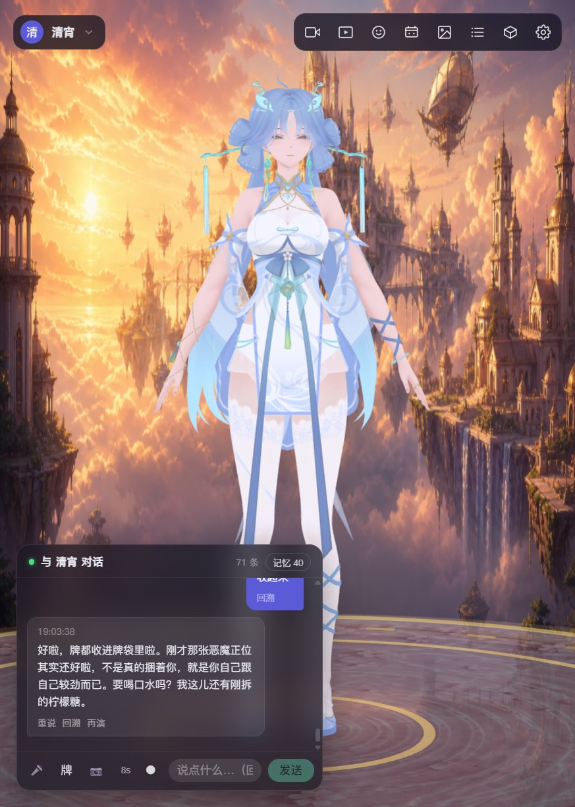
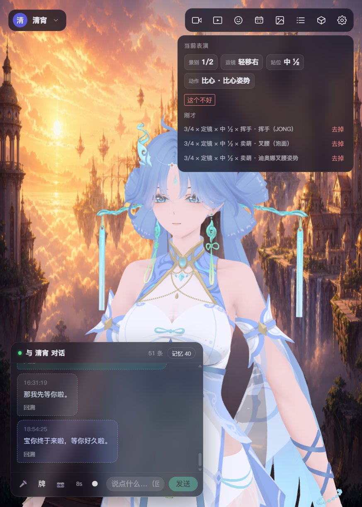
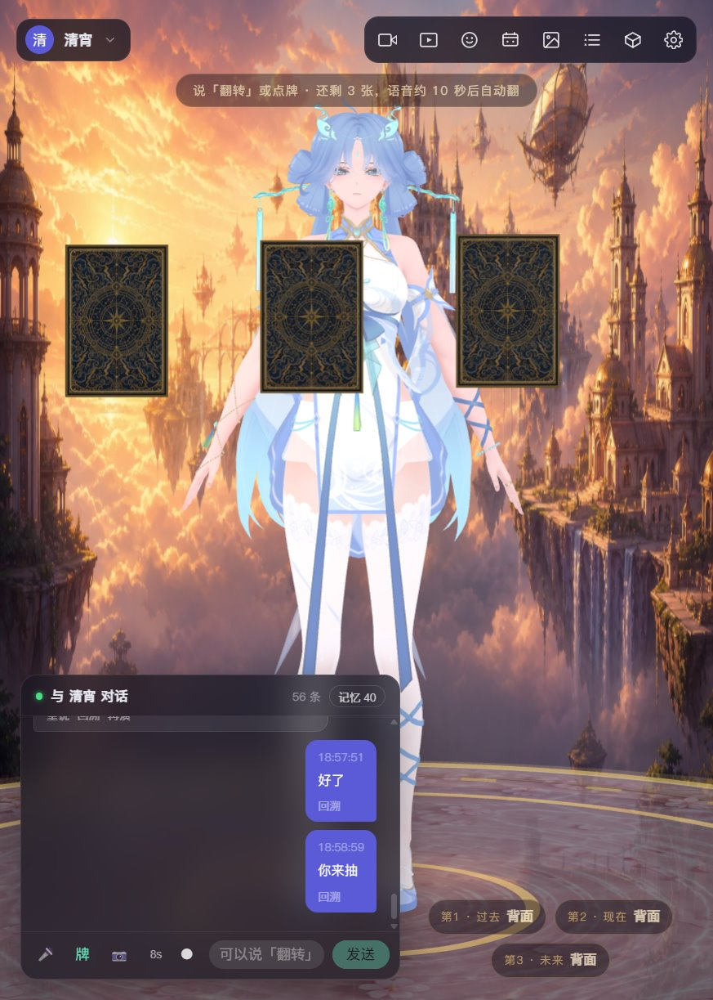

# xiaoke.ai · 小可爱

**开源免费、本地优先的 3D AI 伴侣、虚拟陪玩与透明桌宠。**

与 VRM、MMD（PMX）或 GLB 角色语音聊天：她会说话、对口型、表达情绪、做动作、跳舞并记住你。也可以一起看电影、刷视频、听音乐、玩游戏，或让她安静待在桌面上。

[English](./README.md) · **简体中文** · [官网](https://xiaoke.ai) · [下载](#下载-windows-体验包) · [Discord](https://discord.gg/xxvXxHP8T)

[](./LICENSE)
[](#下载-windows-体验包)
[](#功能一览)

## 为什么选择 xiaoke.ai？

- **看得见、听得见的陪伴。** 语音、口型、表情、动作、舞蹈和电影化运镜共同组成实时 3D 表演，而不只是一个文字聊天窗口。
- **本地优先，注重隐私。** 对话、长期记忆、证物和本地模型权重留在你的电脑上；陪看画面在本机处理，只有你主动配置的云服务会收到相应请求。
- **不止聊天。** 一起看电影、短视频和听音乐，抽塔罗、保存纪念、打开已安装游戏，或接入直播弹幕与礼物互动。
- **角色和配置由你决定。** 导入 VRM、MMD/PMX、GLB 模型，兼容 SillyTavern 角色卡与世界书（Lorebook），自由组合本地或云端对话、语音识别和语音合成服务。
- **免费开源。** 没有会员和次数限制。源码采用 Apache 2.0；第三方模型、动作、音乐和音色仍遵循各自授权。

界面语言和对话语言可独立设置，支持 **简体中文、英语、日语和韩语**。

## 看一看

<table>
  <tr>
    <td width="50%"></td>
    <td width="50%"></td>
  </tr>
  <tr>
    <td align="center">让每段对话都成为实时 3D 表演</td>
    <td align="center">控制运镜、站位、表情和动作</td>
  </tr>
  <tr>
    <td></td>
    <td></td>
  </tr>
  <tr>
    <td align="center">坐在她对面，体验互动塔罗</td>
    <td align="center">创建情境，保存舞台截图和短片</td>
  </tr>
</table>

截图角色为[模之屋](https://www.aplaybox.com/)作者的演示资产，版权归原作者。

## 下载 Windows 体验包

当前预打包版本为 **2026-11-05**，自带 Chromium 和 Python 运行时，目标电脑无需另装 Chrome 或 Python。源码可能包含此体验包之后新增的功能。旧包和变更内容见[历史版本](./HISTORY.zh-CN.md)。

**请下载时间戳均为 `20261105173339` 的 A、B 两个包。** 旧版无时间戳的 `xiaoke-ai-B` 不能搭配此版本。百度网盘的 A、B 位于同一分享文件夹，提取码：`xkai`。

| 包 | 内容 | Hugging Face | Google Drive | 百度网盘 |
|---|---|---|---|---|
| **A** · `xiaoke-ai-agent-A-20261105173339.7z` | 应用程序与运行时 | [下载](https://huggingface.co/datasets/liupigai/xiaokeai/resolve/main/20261105173339/xiaoke-ai-agent-A-20261105173339.7z) | [镜像目录](https://drive.google.com/drive/folders/1mZcD4K90WgO2x2UxteAyMFsQlgTairPl?usp=drive_link) | [同一分享](https://pan.baidu.com/s/1Y3KuQWG761eP08Uktx36Eg?pwd=xkai) |
| **B** · `xiaoke-ai-agent-B-20261105173339.7z` | 角色、动作、音乐、语音和本地视觉模型 | [下载](https://huggingface.co/datasets/liupigai/xiaokeai/resolve/main/20261105173339/xiaoke-ai-agent-B-20261105173339.7z) | [镜像目录](https://drive.google.com/drive/folders/1mZcD4K90WgO2x2UxteAyMFsQlgTairPl?usp=drive_link) | [同一分享](https://pan.baidu.com/s/1Y3KuQWG761eP08Uktx36Eg?pwd=xkai) |

A 也可从 [GitHub Releases](https://github.com/liupig/xiaokeai/releases/tag/a-20261105) 下载，发布页包含中英文说明和完整社区入口。

1. 使用 [7-Zip](https://www.7-zip.org/) 将 A、B 解压到同一层目录，不要互相嵌套。
2. 双击 A 目录中的 `xiaoke-ai.exe`。
3. 在 **设置 → AI 对话** 中填写 OpenAI 兼容接口的 `base_url`、`api_key` 和 `model`。不填密钥也能使用舞台和本地兜底回复。
4. 如需使用自己的角色，在资产中心导入 PMX、VRM 或 GLB 模型。

```text
某盘:\xiaoke\
  xiaoke-ai-agent-A-20261105173339\
    xiaoke-ai.exe
  xiaoke-ai-agent-B-20261105173339\
    xiaoke-content.json
```

**系统要求：** Windows 10+。本地 Qwen TTS 建议使用 NVIDIA 显卡；没有显卡时，选择 **设置 → 语音 → TTS → edge-tts**。体验包不含聊天 API 密钥。

<details>
<summary>使用旧版体验包？</summary>

2026-10-21 及更早的 A 包搭配旧版 `xiaoke-ai-B`，在 **设置 → 资源包** 中选择该目录并重启。文件名不含 `-A` / `-B` 的一体包可直接打开。历史 A 包和版本记录见 [GitHub Releases](https://github.com/liupig/xiaokeai/releases)。

</details>

## 功能一览

### 对话、语音与记忆

- **38 个对话服务预设，加自定义接口：** 支持 OpenAI、Anthropic、Google Gemini、DeepSeek、通义千问、豆包、Kimi、智谱 GLM、MiniMax、OpenRouter 等；本地可选 Ollama、vLLM、SGLang、Player2，也可手动填写任意 OpenAI 兼容接口。
- **分层人设：** 身份、临时扮演、时间、情境、记忆和表演指导分别叠加。支持导入 SillyTavern v1/v2/v3、AICC 角色卡，导出 v2 卡，使用关键词触发的世界书（Lorebook）和可选用户档案。
- **长期记忆：** 通过 mem0 提取偏好、关系和约定，向量保存在本地 Qdrant，并在后续对话中召回。可自动选择向量服务，或手动选择本地 MiniLM、豆包、通义、OpenAI、Gemini 五种后端；记忆可查看、可删除。
- **对话控制：** 查看会话记录、重说上一句、回溯到较早的消息，或不重新请求模型，直接换一种情绪再演一遍。
- **全双工交互：** 边说边听，按句选择打断或排队，沉默后继续交流。Silero VAD 与 WebRTC AEC3 帮助区分你的声音和她正在播放的声音。
- **四种界面与对话语言：** 简体中文、英语、日语、韩语可分别设置界面和对话语言。

#### 语音识别：7 种 ASR

| 引擎 | 运行位置 | 模型 / 说明 |
|---|---|---|
| SenseVoice-Small | **本地 CPU** | 自动识别中文、英语、日语、韩语、粤语，模型约 230MB |
| 阿里云百炼 | 在线 | `qwen3-asr-flash` |
| 火山豆包识别 2.0 | 在线 | `volc.seedasr.sauc.duration` |
| OpenAI | 在线 | `gpt-transcribe` |
| ElevenLabs | 在线 | `scribe_v2` |
| Google Gemini | 在线 | `gemini-2.5-flash` 音频理解 |
| 浏览器 Web Speech | 在线 / 浏览器 | Chrome、Edge |

#### 语音合成：9 种 TTS，另可关闭

本地和云端引擎合计列出 **300+ 预置音色**。口型跟随真实音频振幅；浏览器系统语音没有真实口型。

| 引擎 | 运行位置 | 模型 / 音色 |
|---|---|---|
| Qwen3-TTS | **本地 GPU 流式** | 0.6B 或 1.7B，两套共用 9 个音色，1.7B 支持语气指导 |
| 浏览器系统语音 | 本地 | 使用设备已安装的系统音色 |
| 小米 MiMo | 在线流式 | `mimo-v2.5-tts`，9 个预置音色，支持情绪指导 |
| 火山豆包合成 2.0 | 在线 | `seed-tts-2.0`，100 个音色 |
| 阿里云百炼 CosyVoice | 在线流式 | CosyVoice-v3-Flash，88 个音色 |
| OpenAI TTS | 在线 | `gpt-4o-mini-tts`，13 个音色 |
| ElevenLabs | 在线流式 | Flash v2.5，52 个官方预置音色 |
| Google Gemini TTS | 在线流式 PCM | 30 个音色 |
| edge-tts | 在线流式 | 微软神经网络语音，内置 11 个音色 |

### 3D 舞台与表演

- **三种模型格式：** 热切换 VRM、MMD/PMX、GLB 角色，MMD 支持头发、裙摆和飘带布料物理。
- **舞台外观：** 提供 20 个图片场景、6 个纯色背景和自定义图片，可调整渲染分辨率、灯光、物理、音乐音量及舞台底座。
- **对话即表演：** 流式情绪、动作、舞蹈、运镜和站位标签实时驱动角色；不填对话 API 密钥也能通过本地兜底回复体验表演链路。
- **镜头审查：** 景别 × 运镜 × 站位 × 动作组合经审查后才进入表演，减少穿模和动作错位。
- **实时动捕：** 使用摄像头或本地视频，MediaPipe Holistic 在 Worker 中检测身体、双手和面部。
- **透明桌宠：** 悬浮在其他窗口上方，空白处点击穿透，可拖动和缩放，并记住大小、位置、显示器和当前角色。

### 陪伴与玩法

- **一起看：** 独立的本地 MiniCPM-V 4.7 1B 进程理解带真实时间戳的连续视频，可陪看电影、短视频、玩游戏或听音乐，支持场景上下文和字幕时间轴；画面和声音留在本机。
- **Omni 测试接口：** 通过面壁云端或自建 Gateway 测试 MiniCPM-o 4.5 的文字、语音和图片输入，独立于主舞台管线。
- **触碰反馈：** 在舞台或桌宠上双击不同身体区域，角色会给出相应的姿态和回应；亲疏记录与长期记忆分开保存。
- **塔罗与情境：** 9 种互动牌阵、80 张原创国风牌面，发牌和正逆位由代码决定，内置 22 张情境卡。
- **证物与创作：** 按角色保存舞台截图和短片，使用火山引擎绘图，也可查询天气、价格和新闻。
- **魅影酒馆：** 四人诈牌对局，模型驱动的对手、计分、四套牌面美术、电影化裁决和不阻塞牌局的语音演出。
- **游戏与编程：** 用自然语言打开 WeGame、Steam、Epic 已安装游戏；跟随 Cursor、Codex、Claude Code、通义灵码、Trae、文心快码的本机活动，并在舞台上作出回应。
- **直播互动：** 接收抖音和 B 站弹幕、关注与礼物，支持消息聚合、重连去重、容量与时效队列、播放回执；本机彩排实验室提供虚构观众和故障注入，可测试完整链路。
- **本机金币与许愿：** 通过在线时长和聊天获得金币，使用带道具动画和金币雨的许愿池，无需登录或上传。

### 资产与个性化

- **资产中心：** 导入 ZIP/RAR 压缩包或单个模型、动作、镜头、音频文件，自动修复乱码文件名并分类；支持 VPD 姿势转 VMD，可选对接模之屋搜索和下载。
- **角色控制：** 每个角色可绑定模型、人设、音色、情绪形态键映射、打招呼语和闲置动作偏好，内置 27 个中文人设模板。
- **模块化体验：** 记忆、情境、重说、证物、塔罗、魅影酒馆、Code 伴侣、触碰、Harness 和直播功能可独立开关；一起看和直播接入默认关闭。
- **品牌外观：** 应用、窗口、托盘和安装器可共用配置的 Logo 与配色。

一起看不会点击或操作电脑；停止陪看或关闭应用时，本地视觉进程随之退出。更多实现细节见[功能列表](./companion/docs/features.md)。

## 从源码运行

**前置环境：** Windows、Node.js 18+、Python 3.11+。

```bat
git clone https://github.com/liupig/xiaokeai.git
cd xiaokeai
```

打开两个命令提示符终端。也可以先运行 `companion/start.bat`，自动安装依赖并打开前后端窗口。

**终端 1 — 后端**（`http://127.0.0.1:8600`）

```bat
cd companion\backend
python -m venv .venv
.venv\Scripts\python -m pip install -r requirements.txt
set NO_PROXY=*
set PYTHONUNBUFFERED=1
.venv\Scripts\python -m uvicorn app.main:app --host 127.0.0.1 --port 8600
```

**终端 2 — 前端**（`http://localhost:5175`）

```bat
cd companion\frontend
npm install --legacy-peer-deps
npm run dev
```

打开 **http://localhost:5175**，在设置中配置对话服务。首次启动舞台为空，需要导入模型；离线语音权重会在准备相应模型时下载。

后端不要添加 `--reload` 或 `--workers`；在两个终端按 **Ctrl+C** 停止。详细配置、表演标签协议、PowerShell 命令与排错见[开发指南](./companion/README.md)。

## 仓库结构

| 目录 | 说明 |
|---|---|
| [`companion/`](./companion) | 主产品：Vue 前端、FastAPI 后端、Electron 桌面壳 |
| [`companion/docs/`](./companion/docs) | 产品设计、人设、功能状态、塔罗与开发文档 |
| [`companion-3d/`](./companion-3d) | 早期独立 3D 渲染与动作原型 |
| [`music-api/`](./music-api) | 独立的学习用音乐检索接口 |

仓库包含源码、情境背景、舞台贴图和原创塔罗牌面，不包含第三方 3D 模型、动作、音乐、语音权重、数据库或 API 密钥。资产放置方法见 [`companion/assets/`](./companion/assets) 下的 `README.txt`。

## 技术栈

- **前端：** Vue 3、TypeScript、Vite、Pinia、Naive UI、Three.js、three-vrm、three-stdlib、MediaPipe Holistic
- **后端：** Python 3.11、FastAPI、SQLModel/SQLite、mem0、Qdrant、sherpa-onnx、SenseVoice、Qwen3-TTS
- **桌面端：** Electron、PyInstaller
- **服务集成：** OpenAI 兼容对话接口、edge-tts、阿里云百炼 CosyVoice、MiMo-V2.5-TTS、MiniCPM-V

## 文档

| 文档 | 内容 |
|---|---|
| [开发指南](./companion/README.md) | 配置、语音服务、表演标签协议与排错 |
| [Windows 打包](./companion/README_BUILD.md) | 构建可双击运行的桌面发行版 |
| [完整功能清单](./companion/docs/features.md) | 15 类当前已实现功能 |
| [人设指南](./companion/docs/persona-guide.md) | 角色卡与分层人设设计 |
| [提示词分层](./companion/docs/persona-stack.md) | 系统提示词的组装方式 |
| [塔罗设计](./companion/docs/tarot.md) | 塔罗交互、定位与舞台集成 |

## 社区与贡献

无论你是 AI 伴侣玩家、开发者、角色卡作者、MMD/VRM 创作者、主播，还是单纯想来看看，都欢迎加入。可以聊角色、晒舞台、提建议，也可以一起写代码。

- **QQ 群：** `1124054481` · [群二维码](./companion/frontend/public/community/qq-group.jpg)
- **微信：** `xiaokeai3d` · [微信二维码](./companion/frontend/public/community/wechat-qr.png)
- **Discord：** [加入社区](https://discord.gg/xxvXxHP8T)
- **X：** [@iliuPIG](https://x.com/iliuPIG)
- **YouTube：** [@liupig](https://www.youtube.com/@liupig)
- **GitHub：** [liupig/xiaokeai](https://github.com/liupig/xiaokeai)
- **参与贡献：** 欢迎 fork、自部署、提交 Issue 和 Pull Request。

## 致谢

**[查看完整致谢名单](./ACKNOWLEDGEMENTS.zh-CN.md)**

感谢[模之屋](https://www.aplaybox.com/)社区及各位资产作者，感谢 [Reze MiPo](https://github.com/AmyangXYZ/reze-mipo) 提供的动捕思路，以及 Three.js、VRM、MMD、MediaPipe、Vue、FastAPI、Electron、mem0、Qdrant、Qwen、SenseVoice 等开源项目及其团队。

角色卡兼容基于 [SillyTavern（酒馆）](https://github.com/SillyTavern/SillyTavern)建立的开放生态和社区 [Character Card V2 规范](https://github.com/malfoyslastname/character-card-spec-v2)。完整致谢文档还记录了小冰、豆包、One-Euro Filter 作者、韦特塔罗传统、直播互动参考项目、模型与语音服务商，以及所有为 xiaoke.ai 提供基础的社区和作者。

## 协议

源码和项目原创塔罗／情境美术采用 [Apache License 2.0](./LICENSE)。xiaoke.ai / 小可爱名称与标识不随代码转让；第三方模型、动作、镜头、音乐、音色、角色卡和其他资产遵循原作者条款。再分发或商用前请阅读 [NOTICE](./NOTICE)。

云端 LLM、ASR、TTS 服务商会按其隐私政策处理发送给他们的文字或音频。塔罗仅用于心理视角和娱乐，不构成专业建议。

<details>
<summary>搜索关键词 / Search keywords</summary>

开源 3D AI 伴侣、AI 伴侣、本地 AI 伴侣、开源 3D 陪玩、虚拟陪玩、本地桌宠、透明桌宠、VRM 聊天、MMD 陪玩、AI 虚拟主播、陪看电影、陪刷视频、陪听音乐、视觉互动；Open-source 3D AI companion, 3D AI companion, local AI companion, AI companion, AI waifu, waifu, awesome-ai, virtual companion, transparent desktop pet, VRM chatbot, MMD desktop pet, AI VTuber, AI movie companion, watch a movie together, watch videos together, listen to music together.

</details>
