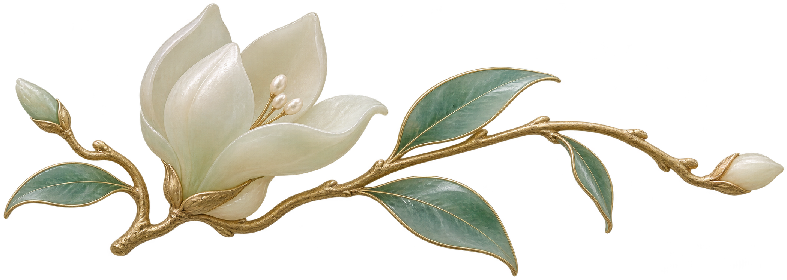

# 汀兰月冠设计原稿

原稿使用内置图像生成工具绘制，同时作为三维花瓣和玉叶的纹理来源。

绘图提示词

Use case: product-mockup. Asset: production-ready transparent orthographic front albedo and relief reference for a prestige Chinese donghua 3D heroine's original magnolia jade crown. Create a SINGLE continuous asymmetrical horizontally long botanical ornament, like a Chinese imperial openwork dian and a museum-quality contemporary hand carved jade hair jewel. Landscape cutout, one object, entire object in frame; width about 2.8x height, no model, no hair, no hairpin shaft, no tiara ring, no base or background. A low arched windswept spray. Visual focal point slightly LEFT of centre: ONE sculptural HALF-OPEN WHITE MAGNOLIA, side three-quarter view, three large upward cupping overlapping elongated white jade tepals plus two smaller, subtly incised, luminous warm ivory with green shadows, delicately bound at its calyx with fine antique champagne gold. NOT a daisy or lotus rosette. From the flower a single graceful curved aged gilt magnolia bough forks, supports everything and sweeps to the RIGHT in a slender rising then descending arc towards a small ivory bud at the far end. A second shorter backshoot curves to the LEFT, with a narrow pale celadon bud. Four or five individually posed rich blue-green translucent carved jade lanceolate leaves set in slender fine gold bezels, one slightly turned edge-on, subdued engraved gold midribs. A few tiny seed-pearl stamens tucked next to the flower. Elegant and intelligible from a distance. The blade shapes, blossoms and the negative spaces are beautifully proportioned; long spaces of air BETWEEN branches, intentional small gaps between petal tips, everything attached. Large confident forms, refined handworked relief, distinct near and far planes; sophisticated Chinese fantasy court taste with restrained Song-inspired floral rhythm. True transparent background including interior cutouts. Even diffuse product lighting with gentle upper left highlights and rich dimensional material color, front-on not dramatic perspective, tack sharp detailed jewelry macro. No birds, wings, heart shapes, rhinestones, lettering, halos, geometric bands, symmetry, tassels, gold outline around the whole object, shadows cast onto the background, or scenery. The gold branch is robust enough to manufacture, petals are luxuriously sculptural. Compose as an isolated horizontal spray, maximum use of canvas.

